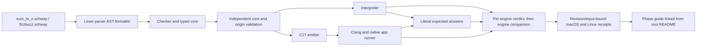

# Phase 27: Exact FizzBuzz and Cross-Host Evidence - Research

**Researched:** 2026-10-03  
**Domain:** Schway source output, U64 remainder semantics, native applications, independent evidence  
**Confidence:** HIGH for locked scope and current repository boundaries; MEDIUM for external C/ASVS guidance. Plan-time syntax choices below are unexecuted decisions.

<user_constraints>
## User Constraints (from CONTEXT.md)

## Locked Decisions

### Bounded source output
- **D-27-01:** Add the smallest explicit source output surface needed by the two examples: `write_text` for compile-time text literals, `write_u64` for decimal U64, and `write_newline` for LF. Do not introduce general string values, interpolation, general formatting, or broad IO.
- **D-27-02:** Let explicitly-writing applications use a narrow `Unit`/no-result entry mode. Preserve the existing `U64 -> U64` app entry behavior that prints the returned value followed by LF. Do not infer print suppression from whether a function happens to write.
- **D-27-03:** Enforce one shared 65,536-byte output limit incrementally at each write chunk. A write that crosses the limit fails; prior bytes may already be visible, and no rollback guarantee is made. Callers and evidence use the process outcome to distinguish success from failure. Keep the public input bound at 1,000; exercise the output boundary with a lowered test-only limit.

### Arithmetic and failure behavior
- **D-27-04:** Add only U64 equality and remainder needed for FizzBuzz. Reject a statically known zero remainder divisor during checking. Check a dynamic divisor before native C `%` so it never reaches C's undefined zero-divisor case. Both engines report the stable reason `U64 remainder by zero`; the public app boundary returns status 65 and exact stderr `schway: U64 remainder by zero\n`. A zero-divisor witness that fails before writing has empty stdout; if a later failure follows successful writes, the streamed prefix can remain.
- Preserve the Phase 26 independent scalar-loop fixed-point analyses and explicit refusal of resource, loan, loan-derived, and unsupported cyclic state across loop back edges.

### Evidence and user guidance
- **D-27-05:** Compare each engine independently against literal expected answers, then compare engines. Include boundary cases, reached wrong-arithmetic/skipped-iteration controls, overflow and zero-remainder controls, repeated loop-event identity, output-limit boundary controls, and actual macOS/Linux native receipts tied to declared inputs. An unavailable host is recorded as unavailable, not a pass. Historical receipts remain identified by their revision and host.
- **D-27-06:** Add one Phase 27 clean-checkout guide/evidence index linked from the root README. It documents how to build and run both programs, exact results, input and output bounds, failure behavior, and host evidence provenance; keep command truth in one place rather than scattering copies.
- **D-27-07:** Keep the dependency tree shallow. Prefer a small copy-local implementation over another dependency unless a concrete need justifies the dependency's maintenance and security cost. No new dependency or backend is needed for this phase.

### the agent's Discretion
- Choose exact syntax and internal operation encoding for the bounded writes, provided the surface stays literal/decimal/LF-only and checker, validators, interpreter, native code, and app behavior agree.
- Choose the focused test-only mechanism for lowering the output limit without changing the public 65,536-byte contract.
- Organize evidence fixtures and the phase guide to match established repository patterns while keeping expected answers independent of both engines.

### Deferred Ideas (OUT OF SCOPE)

- General strings, Unicode APIs, dynamic formatting, collections, and broad IO.
- General division and arithmetic beyond the exact FizzBuzz needs.
- Whole-output buffering, transactional stdout, or rollback guarantees.
- Resource, loan, or loan-derived values carried across loop back edges.
- New dependencies or backends without a named consumer and evidence-backed need.
</user_constraints>

<phase_requirements>
## Phase Requirements

| ID | Description | Research Support |
|----|-------------|------------------|
| U64-02 | U64 comparison, equality, Bool conditions, and remainder have one defined meaning across checking, independent validation, interpretation, and C17 emission; constant zero divisor is rejected and dynamic zero divisor is a defined checked failure. | Extend operator handling through lexer/parser/formatter, typed core, checker and independent peers, interpreter, and C emitter. Test literal zero rejection and dynamic divisor failure independently in both engines. |
| APP-08 | Ordinary Schway source runs exact FizzBuzz for sequence 1…n, including labels, decimal values, line breaks, and final newline. | Add fizzbuzz.schway using only bounded text/U64/LF writes, existing scalar loops/branches, equality, and remainder; pin 0, 1, 15, and 1,000. |
| APP-09 | Both programs accept 0…1,000; larger input fails without application output; writes share a 65,536-byte limit and overflow is non-success. | Preserve the sum gate, add the FizzBuzz gate before the first write, and exercise the shared incremental output guard with a lowered test-only application-output limit. |
| EVD-12 | Independently pinned interpreter/native answers, reached controls, sufficient evidence capacity, and actual macOS/Linux native receipts. | Keep golden answers independent, check each engine against them before engine comparison, add reached mutation/skipped-loop/zero/overflow/identity/capacity controls, and bind host receipts to revision plus declared source/build inputs. |
| DX-16 | Clean checkout can build and run both programs and find expected outputs and limits. | One phase README/index, linked from root README, should own command truth and identify evidence receipts and their host/revision scope. |
</phase_requirements>

## Project Constraints (from AGENTS.md)

- Keep the complete generate/verify/run/observe/repair loop fast; correctness and deterministic evidence take priority over flattering single-number performance claims.
- Use Go 1.24 standard library for Stage 0 and readable C17 emitted to installed Clang for the development native path.
- Prefer standard-library-only and shallow audited boundaries; a dependency must justify its maintenance/security cost over copy-local implementation.
- Preserve Git-friendly formatter-owned text, comment/source-span fidelity, and stable recovery.
- Keep untrusted input, unsafe operations, FFI, secrets, and build authority explicit; do not add a generic untaint or ambient-authority escape.
- At workflow transitions, compare the living product/language roadmaps with source witnesses, refusal boundaries, and evidence tests; distinguish inspection, newly run checks, and historical receipts.
- Prefer a runnable gain in feature phases. Keep independent validation and negative controls tied to the capability; do not add a backend, percentages, or a general planning framework without a concrete consumer.
- Begin file changes through a GSD workflow. This report follows Phase 27 research initialization; keep phase ownership in REQUIREMENTS.md and ROADMAP.md.
- No project skill files were found under .agents/ or .codex/; no additional project skill rules apply. [VERIFIED: AGENTS.md; project skill discovery]

## Summary

Plan a thin vertical extension of the existing M005 path: literal-only text output, decimal U64 output, LF output, U64 equality/remainder, a Unit application entry, and independently adjudicated evidence for both applications. The current source path already has a formatter-owned AST, typed operation core, separate checker/validator consumers, an interpreter, a C17 serializer, and retained native application runner. The producer and peers must all admit the new operations independently; interpreter and C paths must guard zero before applying remainder. [VERIFIED: 27-CONTEXT.md; internal/compiler/core/core.go:701-704; internal/compiler/session/session.go:1345-1387; internal/compiler/cgen/cgen_program.go:2572-2582]

The main integration risk is the app contract: session.BuildApplication currently requires a U64 return, and generated application code auto-prints that return plus LF. Introduce explicit no-result entry semantics without changing the established U64 auto-print route or inferring behavior from writes. Separately, the current C write helper already counts chunks against the output ceiling, but its existing test-only output override is for execution-document serialization; plan a dedicated seam or equivalent that lowers the application stream ceiling without changing the production contract. [VERIFIED: internal/compiler/session/session.go:1360-1367; internal/compiler/cgen/cgen_program.go:1009-1010; internal/compiler/cgen/cgen.go:718-736; internal/compiler/cgen/export_test.go:98-105]

**Primary recommendation:** Keep the source surface literal/decimal/LF-only, use an explicit Unit-returning entry for FizzBuzz, and implement coordinated semantic, app, and evidence slices. Preserve Phase 26 loop analysis/refusals. No dependency or backend is needed. [VERIFIED: 27-CONTEXT.md; 26-RESEARCH.md; go.mod:1-3]

## Architectural Responsibility Map

| Capability | Primary Tier | Secondary Tier | Rationale |
|------------|-------------|----------------|-----------|
| Bounded write syntax and literal admission | Language frontend | Checker/core | Literal-only forms must remain parseable/format-stable and lower to typed operations, not runtime strings. [VERIFIED: 27-CONTEXT.md; internal/compiler/syntax/lexer.go:84-92] |
| Equality/remainder semantics | Checker and typed core | Interpreter, C17 emitter, independent validators | The operator is a language guarantee: every producer, peer and engine must agree, with dynamic zero checked before C %. [VERIFIED: 27-CONTEXT.md; internal/compiler/core/core.go:701-704] |
| App entry and stdout | Native application boundary | C17 emitter and CLI | It owns input range, entry mode, stdout/stderr/status and preserves existing U64 auto-print behavior. [VERIFIED: internal/compiler/session/session.go:1345-1387] |
| Independent expected-answer adjudication | Session/evidence tests | Interpreter and native runner | Engine agreement alone can share a mistake; each result must first match separately authored literal expectations. [VERIFIED: 27-CONTEXT.md; REQUIREMENTS.md EVD-12] |
| Host receipts and clean-checkout guidance | CI/evidence script and phase guide | Root README | Host identity, revision, and declared inputs must be explicit; one guide is the source for commands. [VERIFIED: 27-CONTEXT.md; .github/workflows/ci.yml; scripts/verify-phase25.sh] |

## Standard Stack

### Core

| Technology | Version | Purpose | Why Standard |
|---|---|---|---|
| Go | go 1.24 | Compiler, checker/validators, interpreter, CLI, fixtures and evidence orchestration | The module declares Go 1.24 and project bootstrap locks the Go standard library. Quote: go 1.24. [VERIFIED: go.mod:3; AGENTS.md] |
| C17 + installed Clang | C17; host compiler varies | Readable native lowering and native application execution | Locked project native development path; keep current route. [VERIFIED: AGENTS.md; .github/workflows/ci.yml] |
| Go standard library | Go 1.24 | Parser/compiler implementation, subprocess/test orchestration, output accounting | Dependency posture and existing implementation. [VERIFIED: go.mod:3; 27-CONTEXT.md D-27-07] |

### Supporting

| Component | Version | Purpose | When to Use |
|---|---|---|---|
| Schway interpreter | In-repo | Independent execution of FizzBuzz and failure witnesses | Run literal expected-result cases separately from native outcomes. [VERIFIED: internal/compiler/interp/interp.go; 27-CONTEXT.md D-27-05] |
| Existing native app path | In-repo | Build and execute retained .schway applications with process outcomes | Public commands and native evidence for both programs. [VERIFIED: internal/compiler/session/session.go:1345-1387; cmd/schway/main.go:176-236] |
| Existing C output helper | In-repo | Bounded incremental native writes | Extend the same counted write path used by app output; do not add a parallel output mechanism. [VERIFIED: internal/compiler/cgen/cgen.go:718-736] |

**Installation:** None. No external packages are required. Package Legitimacy Audit is not applicable because the phase adds no packages. [VERIFIED: 27-CONTEXT.md D-27-07]

### Alternatives Considered

| Instead of | Could Use | Tradeoff |
|---|---|---|
| Literal-only write_text plus decimal and LF operations | General String/interpolation/formatting library | General text expands types, ownership, encoding and runtime surface beyond this consumer; deferred by locked scope. [VERIFIED: 27-CONTEXT.md D-27-01 and Deferred Ideas] |
| Existing interpreter + C17/Clang | New VM/LLVM/backend or formatting dependency | Adds a new semantic/runtime boundary with no named Phase 27 consumer. [VERIFIED: ROADMAP.md Phase 27; 27-CONTEXT.md D-27-07] |

## Architecture Patterns

### System Architecture Diagram

### Recommended Project Structure

    examples/
    ├── sum_to_n.schway                 # Existing ordinary-source U64-return witness
    └── fizzbuzz.schway                 # New Unit-entry explicit-output witness
    internal/compiler/
    ├── syntax/                         # Tokens, grammar, formatting and recovery
    ├── core/                           # Typed equality/remainder/write operations
    ├── check/                          # Producer checking and literal-zero rejection
    ├── corevalidate/ originvalidate/   # Independent operation and loop-state derivation
    ├── interp/                         # Checked remainder and bounded writes
    ├── cgen/                           # Guarded C17 remainder and counted output chunks
    ├── session/ native/                # Unit app entry, outcomes and expected answers
    scripts/                            # Phase host receipt driver, patterned on Phase 25
    examples/phase27/README.md          # Single command/evidence index, linked from root

These are recommendations against current repository seams and locked scope, not claims that the new files exist. [VERIFIED: 27-CONTEXT.md; current source paths]

### Pattern 1: Keep writes explicit and statically bounded

**What:** Add only write_text with compile-time literal operand, write_u64 with U64 operand, and write_newline; lower each to a typed core operation. No runtime string value or generic formatting path. Ensure formatter/parser preserve source text and spans. [VERIFIED: 27-CONTEXT.md D-27-01]

**When to use:** FizzBuzz witness and any minimal shared output needed for sum_to_n's existing output route. [VERIFIED: ROADMAP.md Phase 27; 27-CONTEXT.md]

**Planning detail:** Current lexer recognizes quoted tokens but comments that string literals are only used for allocator identity; parsing a literal as an argument is therefore not evidence of a supported string value. Keep the argument compile-time-only at checking/lowering. [VERIFIED: internal/compiler/syntax/lexer.go:84-92]

### Pattern 2: Define remainder before mapping it to host operators

**What:** Reject known zero divisor in the checker; independently validate the core operation and reject dynamic zero at runtime in both engines. C emission must branch to the stable failure before evaluating %. WG14 materials identify zero as undefined behavior for C division/remainder, so this guard is required for the locked cross-engine contract. [VERIFIED: 27-CONTEXT.md D-27-04; CITED: [WG14 Defect Report 415](https://open-std.org/JTC1/SC22/WG14/www/docs/dr_415.htm)]

**When to use:** Every admitted U64 remainder, including the dynamic-zero witness required to prove the native guard. [VERIFIED: 27-CONTEXT.md D-27-04/D-27-05]

### Pattern 3: Select app behavior from its declared return mode

**What:** Preserve U64-to-U64 automatic decimal value and LF; permit the locked narrow Unit/no-result path to rely on explicit writes and suppress only automatic return printing. Do not infer mode from observed writes. [VERIFIED: 27-CONTEXT.md D-27-02]

**When to use:** sum_to_n remains U64-returning; fizzbuzz is explicitly-writing Unit-returning. [VERIFIED: examples/sum_to_n.schway; 27-CONTEXT.md]

### Pattern 4: Enforce a single incremental byte budget

**What:** Check each chunk against remaining capacity before writing it; update the count only for a completed chunk. At a crossing write, return non-success, with previously streamed chunks permitted to remain. Do not conflate application output with evidence-report/capture capacity. [VERIFIED: 27-CONTEXT.md D-27-03; internal/compiler/cgen/cgen.go:718-736]

**Test seam:** SetExecutionOutputLimitForTest overrides executionOutputLimit for serialized execution documents; it is not an application stdout-limit control. Add a separate test-only application limit seam or equivalent, restoring it after every test. Production value stays 65536 bytes. [VERIFIED: internal/compiler/cgen/export_test.go:98-105; internal/compiler/cgen/cgen_program.go:31,728-729; internal/compiler/cgen/cgen.go:718-736]

### Anti-Patterns to Avoid

- Route output through general runtime strings or formatting: expands the language beyond literal/decimal/LF operations. [VERIFIED: D-27-01 and deferred scope]
- Let C % see a dynamic zero divisor: C behavior is undefined; guard before the expression. [CITED: WG14 DR 415; VERIFIED: D-27-04]
- Use stdout writes to infer entry mode: violates explicit Unit-vs-U64 behavior. [VERIFIED: D-27-02]
- Buffer all output to promise rollback: contradicts the streaming contract; earlier chunks may remain after failure. [VERIFIED: D-27-03/D-27-04]
- Count unavailable hosts, exhausted evidence buffers, or engine agreement as passes: each engine must satisfy pinned answers and actual host receipts must exist. [VERIFIED: D-27-05; REQUIREMENTS.md EVD-12]
- Relax Phase 26 loop analysis while adding operators: equality/remainder do not justify admitting resource/loan/unsupported cyclic state. [VERIFIED: D-27-04; 26-RESEARCH.md]

## Don't Hand-Roll

| Problem | Don't Build | Use Instead | Why |
|---|---|---|---|
| App process/outcome transport | A second runner or output channel | Existing retained application route | It already separates stdout/stderr and process outcomes. [VERIFIED: cmd/schway/main.go:176-236; 27-CONTEXT.md] |
| Numeric decimal conversion | A dependency or general formatter | Existing native U64 decimal writer and interpreter/app conversion paths, extended only if source operations require it | C generator already has a decimal U64 writer; general formatting is out of scope. [VERIFIED: internal/compiler/cgen/cgen_program.go:1773-1788; D-27-01] |
| New semantic truth authority | A checker-produced allow bit imported by every consumer | Existing independent core/origin validation pattern | Shared inference would weaken required independence. [VERIFIED: 27-CONTEXT.md code_context; REQUIREMENTS.md U64-02] |
| Host matrix orchestration | New CI service/backend | Existing GitHub Actions Ubuntu/macOS matrix and Phase 25 host-evidence pattern | CI already provisions both host families and records host/compiler context. [VERIFIED: .github/workflows/ci.yml; scripts/verify-phase25.sh] |

**Key insight:** The source feature is small, but crosses several trust boundaries. Separate parser/operator admission, independent semantic derivation, runtime output behavior, and evidence receipt work while retaining one end-to-end witness. [VERIFIED: phase context and current integration points]

## Common Pitfalls

### Pitfall 1: C remainder executes before zero validation

**What goes wrong:** Native undefined behavior while interpreter reports the intended failure. **Why:** C division/remainder with zero divisor is undefined. **How to avoid:** Emit zero test before C %; add a reached dynamic-zero witness asserting status 65, exact stderr, and empty stdout when no prior output exists. **Warning signs:** Only constant divisors 3/5 are tested or only emitted C text is checked. [CITED: WG14 DR 415; VERIFIED: D-27-04]

### Pitfall 2: Static zero handling does not cover dynamic zero

**What goes wrong:** Checker catches x % 0, but dynamic zero reaches execution unchecked. **How to avoid:** Test source-known zero diagnostics and dynamic-zero runtime behavior in interpreter and native. [VERIFIED: D-27-04/D-27-05]

### Pitfall 3: Auto-print changes for sum_to_n

**What goes wrong:** FizzBuzz gains a trailing 0 newline, or a function with writes stops returning legacy U64 output. **How to avoid:** Key app behavior from entry return mode; pin sum and FizzBuzz streams independently. [VERIFIED: D-27-02; examples/sum_to_n.schway]

### Pitfall 4: Output cap is conflated with evidence cap

**What goes wrong:** Capture exhausts but child appears successful, or evidence bytes are charged as app bytes. **How to avoid:** Keep counters separate; test exact boundary and one crossing write under a lowered app-only ceiling, asserting non-success and permitted streamed prefix. [VERIFIED: D-27-03/D-27-05; internal/compiler/cgen/cgen.go:718-736]

### Pitfall 5: FizzBuzz branch ordering or range errors

**What goes wrong:** Multiples of 15 print one label, loop includes 0/skips n, or n=0 emits LF. **How to avoid:** Use goldens for 0, 1, 15 and 1,000; prioritize combined divisibility; compare exact bytes including final LF. [VERIFIED: 27-CONTEXT.md; ROADMAP.md Phase 27]

### Pitfall 6: Engine agreement or incomplete host receipts are treated as proof

**What goes wrong:** A common-mode error passes, or a single host is called dual-host proof. **How to avoid:** Check each engine against independent answers first; bind actual macOS/Linux receipts to revision and declared inputs; label absent host unavailable. [VERIFIED: D-27-05; REQUIREMENTS.md EVD-12; scripts/verify-phase25.sh]

### Pitfall 7: Repeated event sites collapse across loop executions

**What goes wrong:** Identity collision makes trace ambiguous or incomplete. **How to avoid:** Reuse Phase 26 invocation/static-site occurrence identity and test it in this witness; keep event capacity distinct from child outcome. [VERIFIED: 26-RESEARCH.md repeated-event pattern; D-27-05]

## Code Examples

The following shows intended behavior; exact text literal grammar and call spelling are at the agent's discretion and are not implemented. This skeleton is illustrative, not verified source syntax. [ASSUMED]

    fn main(n: U64) -> Unit {
      var i = 1
      while i < n + 1 {
        if i % 15 == 0 {
          write_text("FizzBuzz")
        } else if i % 3 == 0 {
          write_text("Fizz")
        } else if i % 5 == 0 {
          write_text("Buzz")
        } else {
          write_u64(i)
        }
        write_newline()
        i = i + 1
      }
    }

This is not necessarily executable as written: equality token, chained conditional syntax, literal delimiters, Unit grammar, and avoiding n+1 overflow need planning. Use an established pre-tested loop with a terminal state bounded at 1,000. Keep the locked outputs and bounds fixed while selecting source details. [ASSUMED]

## State of the Art

| Old Approach | Current Phase 27 Approach | When Changed | Impact |
|---|---|---|---|
| App entry must return U64 and wrapper prints decimal plus LF | Preserve U64 auto-print and add explicit no-result Unit entry for write-driven apps | This phase | Entry validation and generated shell need declared return-mode handling. [VERIFIED: internal/compiler/session/session.go:1360-1367; D-27-02] |
| No source-level explicit output or U64 remainder | Literal text, decimal U64, LF, equality and remainder only for FizzBuzz | This phase | Add tokens/AST/core operations through semantic consumers; no general string or division feature. [VERIFIED: 27-CONTEXT.md D-27-01/D-27-04] |
| Phase 26 cross-host app evidence covers sum semantics | Phase 27 evidence independently closes both program outputs, shared output bound, and macOS/Linux receipts | This phase | Old receipts remain historical; new revision needs its own native runs. [VERIFIED: D-27-05; REQUIREMENTS.md] |

**Deprecated/outdated:** M004 and Phase 26 receipts are scoped to their recorded revision/program; neither proves Phase 27 operators, output, or evidence. [VERIFIED: 27-CONTEXT.md D-27-05; STATE.md]

## Assumptions Log

| # | Claim | Section | Risk if Wrong |
|---|---|---|---|
| A1 | Witness can use a narrow compile-time text operand without a runtime String value. | Code Examples | Parser/type architecture may require another literal-only representation; keep it compile-time-only per D-27-01. |
| A2 | Existing process outcomes distinguish output-limit non-success from success without public evidence schema changes. | Architecture Patterns | If false, outcome and capture adapters need coordinated work; limit crossing still cannot return success. |
| A3 | CI can provide actual macOS and Linux execution for the final Phase 27 revision. | Environment Availability | If a host cannot run, mark unavailable and do not claim dual-host acceptance. |
| A4 | Dedicated test-only generated-C app output limit is feasible without changing public 65,536-byte limit. | Architecture Patterns | Otherwise choose another test-only mechanism without broadening public input bounds. |

## Open Questions

1. **RESOLVED — source syntax for literal text and Unit entries.**
   - Choice: Plans 27-01/02 admit write_u64(expr), write_newline(), and an explicit Unit return annotation with no result expression; Plan 27-05 admits only write_text("literal") with compile-time decoding, and Plan 27-06 emits its exact bytes. == and % are the U64 operator spellings in Plans 27-03/04. A Unit app does not auto-print; a U64-returning sum_to_n still auto-prints decimal value plus LF. [PLANNED: D-27-01/D-27-02; 27-01 through 27-06-PLAN.md]
2. **RESOLVED — output-limit crossing process outcome.**
   - Choice: Plan 27-07 chooses public exit status 65 and exact stderr schway: application output limit exceeded followed by LF. The crossing chunk is not written; already completed chunks remain streamed and no rollback is promised. A lowered test-only limit exercises this, while production remains 65,536 bytes. [PLANNED: D-27-03; 27-07-PLAN.md Tasks 1-2]
3. **RESOLVED — dual-host receipt acquisition.**
   - Choice: Plan 27-09 adds scripts/verify-phase27.sh to the existing Ubuntu/macOS CI matrix, uploads per-host artifacts and applies a same-revision/input-hash receipt gate; Plan 27-10 acquires the completed hosted job artifacts and records both actual receipts. Missing or unavailable hosts remain unavailable, never passing. [PLANNED: D-27-05; 27-09-PLAN.md Tasks 1-2; 27-10-PLAN.md Task 2]

These are plan-time choices, not claims that Phase 27 implementation tests or hosted jobs have run.

## Environment Availability

| Dependency | Required By | Available | Version | Fallback |
|---|---|---|---|---|
| Go | Compiler/test and native evidence | Yes | go1.24.0 darwin/arm64 | None for required native route. [VERIFIED: live go version; go.mod:3] |
| Clang | Native C17 app | Yes | Apple clang 21.0.0 (clang-2100.1.1.101) | None locally; hosted matrix covers Linux. [VERIFIED: live clang --version] |
| Linux native host | Actual Linux receipt | Not available in local macOS process | — | Existing CI Linux runner; absent execution is unavailable, not pass. [VERIFIED: ci.yml; live host probe] |
| Third-party packages | None | Not required | — | —. [VERIFIED: D-27-07] |

No project tests, build, application execution, or native evidence were run. Toolchain versions are availability probes only. [VERIFIED: research session]

## Validation Architecture

### Test Framework

| Property | Value |
|---|---|
| Framework | Go standard testing package; module declares go 1.24. [VERIFIED: go.mod:3; existing *_test.go files] |
| Config file | None identified; Go module defaults apply. [VERIFIED: repository file scan] |
| Quick run command | Focused touched-package tests; exact selectors are plan-time choices. [ASSUMED] |
| Full suite command | go test ./... and go test -race ./... in hosted CI. [VERIFIED: .github/workflows/ci.yml] |

No Nyquist tests were run during research. Keep implementation tests in existing packages and do not count historical receipts as current checks. [VERIFIED: AGENTS.md; workflow]

### Phase Requirements → Test Map

| Req ID | Behavior | Test Type | Automated Command | File Exists? |
|---|---|---|---|---|
| U64-02 | Equality/remainder through syntax/checker/peers/interpreter/C; literal zero rejected; dynamic zero fails consistently | Unit + native integration + negative controls | Focused syntax, check, corevalidate, originvalidate, interp, cgen and session tests | Existing package suites; new cases needed |
| APP-08 | Exact 0, 1, 15, 1,000 output and LF; reject 1,001 | App integration | Focused session/native/CLI tests against literal bytes | Sum patterns exist; new witness/cases needed |
| APP-09 | Both apps reject 1,001 before output; crossing app limit fails under lowered test threshold | App boundary integration | Output-count boundary and app process outcome tests | Existing writer; app-only test seam/control needed |
| EVD-12 | Each engine vs independent golden; wrong arithmetic/skips/overflow/zero/identity/capacity; actual macOS/Linux receipts | Evidence integration + host matrix | Focused controls plus proposed `sh scripts/verify-phase27.sh` | Phase 26 test patterns exist; host script/controls needed |
| DX-16 | Clean-checkout commands and index for both programs | Documentation contract + manual clean-checkout run | Docs contract test plus guide commands | Phase 24 README pattern exists; guide and root link needed |

### Sampling Rate

- **Per task commit:** smallest touched-package tests plus discriminator/negative control.
- **Per wave merge:** focused Phase 27 source, interpreter, native app, output-limit and evidence cases.
- **Phase gate:** full Go and race suites plus actual hosted macOS/Linux Phase 27 receipt; incomplete/capacity-exhausted evidence fails closed.

### Wave 0 Gaps

- [ ] Add examples/fizzbuzz.schway with bounded input, multiple-of-15 priority, explicit LF output, and Unit app entry.
- [ ] Add literal expected-output fixtures independent of both engines for 0, 1, 15, 1,000 and rejected input.
- [ ] Add syntax/formatter recovery and literal-only admission tests for writes and selected equality/remainder spelling.
- [ ] Add checker/independent-validator tests for constant zero, dynamic zero facts, operation mutations, and preserved loop back-edge refusals.
- [ ] Add interpreter/native dynamic zero, output-limit exact/crossing, overflow and streamed-prefix outcome tests.
- [ ] Add reached wrong-arithmetic/skipped-iteration controls, repeated event identity assertions, and evidence-capacity exhaustion controls.
- [ ] Add Phase 27 host receipt script/workflow wiring and guide linked from root README.

## Security Domain

Security enforcement is enabled at ASVS Level 1 in project config. OWASP positions ASVS as a basis for web application technical-control verification; this phase is a local compiler/CLI/native toolchain, so use categories as analogous review prompts and do not claim ASVS certification. [VERIFIED: .planning/config.json security_enforcement true/security_asvs_level 1; CITED: [OWASP ASVS](https://owasp.org/projects/asvs)]

### Applicable ASVS Categories

| ASVS Category | Applies | Standard Control |
|---|---|---|
| V2 Authentication | No | No identity/auth boundary in this phase. [VERIFIED: phase scope] |
| V3 Session Management | No | No browser/session/cookie state. [VERIFIED: phase scope] |
| V4 Access Control | Yes, semantic authority | Require checked facts and independent validators before native emission; do not let literal-write or remainder operations forge proof. [VERIFIED: U64-02; source pipeline] |
| V5 Input Validation | Yes | Preserve source/input limits and reject n>1,000 before first write; reject nonliteral text at compile time. [VERIFIED: D-27-01/D-27-03; APP-09] |
| V6 Cryptography | No | No cryptography introduced. [VERIFIED: phase scope] |

### Known Threat Patterns for Go/C compiler

| Pattern | STRIDE | Standard Mitigation |
|---|---|---|
| Dynamic zero divisor reaches emitted C % | Integrity / availability | Check before %; fail deterministically with same reason in both engines. [CITED: WG14 DR 415; VERIFIED: D-27-04] |
| Repeated or oversized writes bypass output count | Denial of service | Check remaining bytes per chunk; keep one bounded counter and test exact/crossing thresholds. [VERIFIED: D-27-03] |
| Input bound check happens after first output | Integrity | Validate n<=1,000 before writes; prove rejected input has empty stdout. [VERIFIED: APP-09; D-27-03] |
| Checker-only operation admission | Tampering / privilege boundary | Re-derive support in independent validators and test forged/changed core claims. [VERIFIED: U64-02; code context] |

## Sources

### Primary (HIGH confidence)

- 27-CONTEXT.md — locked behavior, discretion, deferrals and boundaries.
- REQUIREMENTS.md and ROADMAP.md Phase 27 — acceptance and phase ownership.
- STATE.md, PRODUCT-ROADMAP.md, LANGUAGE-MATURITY.md — current provenance, successor direction, demonstrated capabilities/refusals.
- AGENTS.md, go.mod, .github/workflows/ci.yml, scripts/verify-phase25.sh — constraints, Go version, host matrix and receipt pattern.
- examples/sum_to_n.schway and internal/compiler syntax/core/check/validation/interpreter/C/native/session packages — source-inspected seams. No builds or tests run.

### Secondary (MEDIUM confidence)

- [WG14 Defect Report 415](https://open-std.org/JTC1/SC22/WG14/www/docs/dr_415.htm) — C zero-divisor behavior context; the phase contract remains normative for Schway.
- [OWASP ASVS project](https://owasp.org/projects/asvs) — scope framing, applied only as analogous checklist to this non-web phase.

### Tertiary (LOW confidence)

- Illustrative source skeleton and exact syntax questions — assumed because Phase 27 syntax is not implemented or locked.

## Living Direction Check

This is the last M005 runnable slice before the roadmap's next ranked candidates. The living roadmap continues to rank (1) practical computation, now closing with sum_to_n plus FizzBuzz; (2) a bounded checksum/file-byte utility with only consumer-required byte operations and local modules; and (3) bounded JSON configuration only when a real Schway tool needs it. After Phase 27, revisit the order against a named consumer: checksum is blocked on byte/index/module surface and its witness remains provisional/refused; JSON lacks a named config consumer. The smallest next action is scope the second consumer before reusable byte APIs; checker/guarantee changes depend on its required operations; evidence needs malformed/bounds controls and independent answers. Reprioritize if a named user program identifies a smaller, higher-value safe slice. [VERIFIED: PRODUCT-ROADMAP.md; LANGUAGE-MATURITY.md; AGENTS.md]

## Metadata

**Confidence breakdown:**
- Standard stack: HIGH — project stack is locked, existing, and no external package is proposed.
- Architecture: HIGH for present seams; MEDIUM for unimplemented Unit/literal-write encodings.
- Pitfalls: HIGH for zero-divisor, output-bound, entry-mode and independent-evidence constraints grounded in locked decisions and source.

**Research date:** 2026-10-03  
**Valid until:** 2026-11-02 for stable repository architecture; refresh if Phase 27 implementation changes the output/evidence boundary.

**Evidence scope:** Source/document inspection and local tool availability only. No project tests, builds, app runs, or host receipts were performed. Historical Phase 26 receipts establish only Phase 26 behavior.
