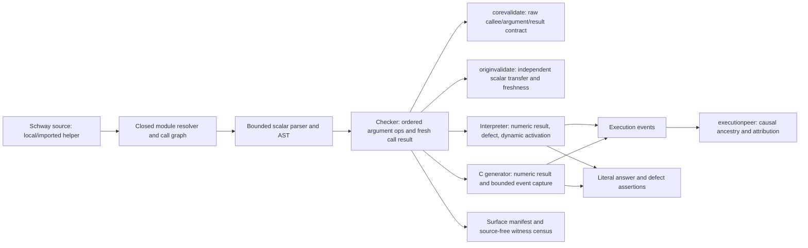

# Phase 36: Scalar Helper Calls - Research

<user_constraints>
## User Constraints (from CONTEXT.md)

### Locked Decisions

#### Bounded composition and source contract

- **D-01:** Use Go 1.24 standard library and small local code over dependencies. Reuse direct `OpCall`, `core.Function.Parameter`, existing module composition, interpreter frames, and readable C17/Clang. Preserve current core/execution/diagnostic schema names and wire fields. Sharing mechanical identity formatting is acceptable; sharing a producer's semantic verdict between independent peers is not.
- **D-02:** Admit all four signature pairs U64→U64, U64→Bool, Bool→U64, Bool→Bool for scalar helpers. Require exactly one parameter, exact argument type, and target type from the declared return type. No implicit Bool/U64 conversion, numeric truthiness, Unit value result, Byte operand conversion, or new resource/pointer/ByteView value-call signature. Preserve existing U64/ByteView/unused-Byte and Unit-body routes separately. The unused Byte bridge stays provably unused even in a call argument.
- **D-03:** Add a direct named-call scalar expression whose single argument is an already admitted scalar expression, including computed and nested calls. Reuse the existing 64-level expression-depth accounting and bounded delimiter-aware recovery; count call-argument recursion in that bound. Calls bind as atoms tighter than infix operators. Keep legacy non-scalar call grammar and ordinary arity-one refusals intact. Name-only arguments were considered but rejected here because an arbitrary special restriction would impede composition while the bounded scalar parser and ordered lowering already exist.
- **D-04:** Calls may appear wherever scalar expressions are already admitted, including binding/assignment RHS, operands, conditions, byte-index expressions, and another helper's argument, subject to the existing context's type rules. Preserve the current identifier-tail source form: a Bool helper returns an initialized Bool local or formal by identifier; bind a call result before returning it. No general expression-tail expansion or Bool literals follow. Keep `true`/`false` contextual identifiers and existing unsupported forms/hints.
- **D-05:** Fully evaluate the argument once before helper entry. Lower nested calls and sibling operands left-to-right into explicit fresh typed places and ordered `OpCall` operations; complete the call before evaluating the next operand or storing its assignment result. Do not emit nested C expressions that rely on C operand order. An argument defect prevents helper entry, later operands, and the store. Preserve existing admitted scalar writes and defect behavior; do not invent a purity annotation or silently duplicate effects.

#### Calls, imports, and static guarantees

- **D-06:** Resolve local and imported helper targets through the existing closed whole-program module resolver, explicit exports, stable semantic IDs, and signature lookup. Reuse in-root/case/symlink/import-cycle limits unchanged. Test colliding names, declaration order, and a private/unimported target. No package manager, module search path, separate compilation, or newly module-aware query/interface route.
- **D-07:** Preserve the existing whole-program call-graph policy and refusal code: direct and mutual recursion are refused even in unused functions or unreachable blocks. Keep existing graph/depth/resource bounds, including the 4096 static invocation-path bound and interpreter depth limit 128; do not equate acyclicity with bounded dynamic work or allocate an unbounded unfolded DAG before refusal.
- **D-08:** Check, corevalidate, and originvalidate independently enforce callee existence/signature, initialized compatible argument, scalar-safe call context, correct result type, and a valid fresh call-result target. A call initializes its target to a value-unknown scalar of the declared result type. Do not import producer summaries or implement mandatory exact-return constant propagation. Preserve local constant/zero-divisor analysis; a helper result that happens to be zero follows the dynamic remainder-defect route unless independently proved by an existing law.
- **D-09:** Keep the distinction between a fresh static call-result temporary and assignment to a mutable local. Repeated execution of that static producer in a loop is legitimate; reusing a prior static producer's target in malformed raw IR is not. Include prior constant/copy/store/call targets, wrong fields/types, missing arguments/results, and positive branch/loop assignment shapes in direct independent validator controls. Check success must not mask a raw-peer refusal.
- **D-10:** Preserve all existing resource, loan, provenance, back-edge and path-oracle restrictions. A scalar value call does not authorize ownership/loan/event state on loop back edges or widen by-reference contracts. Update actual scalar-kind/CFG trigger inventories and explicit event allowances needed for this feature, rather than blanket allowlisting `OpCall` everywhere. Preserve ByteView argument ownership through the old owning-wrapper seam only.

#### Dynamic invocation and bounded evidence

- **D-11:** Give repeated calls at the same static site distinct activations using the existing `InvocationSegment.Ordinal`: zero-based, contiguous per `(parent dynamic invocation, static OpCall ID)`. A fresh parent activation resets its child-site counters; separate sites and nested parents remain distinct. First/nonrepeated activations retain ordinal zero and old canonical spelling. Reusing the same invocation path with only event occurrences was considered but rejected because the existing public invocation grammar explicitly names caller-owned call-site occurrences. No new wire field/schema is needed.
- **D-12:** Interpreter, C emission, and executionpeer independently construct/check ordinal progression and ancestry. Keep event `Occurrence` for repetitions inside one activation; it does not replace activation identity. Reject missing/skipped/duplicate/reordered ordinals, wrong parent/site/callee, repeated terminal events, missing/unbalanced calls/returns, forged defects, and events after the terminal defect. Test one site called more than once, two sites targeting one callee, nested helper calls, a helper with its own loop, and a later-iteration defect.
- **D-13:** Retain bounded static preflight and existing execution-document (16 MiB), application-capture (64 KiB), runtime event/output, and call-depth limits. Dynamic counter/path construction must be bounded and checked before wrap or allocation. The planner may choose a small local bounded representation; it must distinguish static source refusal from runtime evidence exhaustion. Do not silently turn the 4096 static-node ceiling into a new semantic input/call-count limit. No global tracing heap or resident runtime.
- **D-14:** Native capacity reservation must account for calls, callee return/failure/defect records, invocation text, and repeated loop activations. The current sum of static operations is not a complete dynamic bound. Require a finite repeated-call witness whose captured trace is complete and independent exact boundary/exhaustion controls. Preserve named conformance capacity exit 69 and application capture's incomplete/capacity-exhausted status, separate from the application's own streams/outcome. Optional evidence exhaustion must not invent success or silently suppress a program defect. Do not promise complete per-call evidence for arbitrary Phase 37 CRC file sizes; Phase 37 must apply the existing ordinary-run versus capture/verification distinction.
- **D-15:** Executionpeer proves observed causal call structure, argument/result place/type attribution where represented, invocation ancestry, event order and terminal defect attribution. It has no scalar argument/result payload and cannot prove arithmetic or distinguish a plausible success trace from a numerically required defect. Keep Phase 35 D-18's boundary; no numeric replay, new operand events, interprocedural evaluator, or identical-mutant-at-every-peer requirement.

#### Defects and acceptance clarification

- **D-16:** New U64/Bool helpers propagate their actual callee overflow/remainder reason through nested calls and loops on interpreter and native, exit 65, with no normal caller continuation or fabricated result. Exercise dynamic inputs so static zero/overflow refusal cannot substitute for execution. Pin exact reason/stdout/stderr/exit through the relevant application seam and capture attribution separately. No new failure kind or optimizer attribute.
- **D-17:** A U64/Bool-only helper cannot read bytes: `byte_at` requires the function's ByteView formal. Preserve the existing owning-wrapper→ByteView scalar callee bounds-defect row on interpreter fixture/file runners and native application C. This is a compatibility regression, not a new ByteView scalar-to-scalar admission. Separately test `helper(byte_at(bytes, index))` inside a ByteView caller: OOB occurs in the caller before helper entry, emits no helper invocation, and preserves existing live-owner abort-like behavior. Never label that as a bounds fault inside a U64/Bool helper.
- **D-18:** **Dated acceptance clarification (2026-10-14):** Preserve the original CALL-01/02 and Phase 36 roadmap demands as provenance; interpret them through D-08/D-15/D-17. New-callee defect rows are overflow/remainder; bounds remains the existing ByteView-callee regression plus the new argument-order control. Check lowers the actual source argument/result; raw peers independently enforce valid IR contracts; engines catch same-typed argument/result substitutions and swallowed numerical defects; executionpeer catches causal and attribution forgeries. Record this in the live requirements and final verification. Do not claim that a source-blind peer can reject well-typed IR merely because it differs from source intent.

#### Compatibility, evidence, and runnable gain

- **D-19:** Before compiler edits, commit an enumerated literal generated-C baseline through all relevant current emitter routes for tracked source programs without the newly admitted scalar calls/signatures. Record non-emitting rows explicitly. Keep earlier frozen goldens immutable; no broad path exemptions, regenerated expected C, or accidental removal of old programs. Arm live C-byte drift, omitted-row, and false-exemption controls. Intentional new source fixtures get explicit rows, not a waiver for unrelated output changes.
- **D-20:** Make a small ordinary-source `crc_step`-style U64 helper that performs a reflected bit step using Phase 35 operators and is called repeatedly in a loop. Add a local call and an importing module using that helper, with literal independently calculated answers. This is a bounded helper witness, not the Phase 37 complete CRC file consumer. Cover all four U64/Bool signature pairs, nested/computed arguments, result used in an arithmetic expression and mutable assignment, and a Bool result used in a condition. Use discriminating nonidentity values; identity/zero alone cannot detect dropped arguments or results.
- **D-21:** Keep public route claims exact: parameterized U64 `main` still needs input and public conformance `run` does not gain a new U64 input flag/default. A suitable unused-Byte public wrapper may demonstrate a constant-fed helper while preserving unused-Byte laws. Native retained applications and the existing interpreter application seam prove exact decimal stdout separately. The ByteView owning wrapper uses its existing application/fixture path; do not assert that the conformance shell admits it. Public interpreter file routing remains Phase 37.
- **D-22:** Plan finite controls per actual knower: checker source-lowering argument/result selection, independent raw-core/origin refusal-removal tests, each engine's literal answers and dropped-argument/result/swallowed-defect controls, and executionpeer's event/ordinal/attribution controls. Use fresh positive/no-op/restored baselines; a compile/vet failure, missing test selector, unrelated assertion, or source rejected before the target is not a killed semantic mutant. Reuse the small overlay/local-seam patterns from Phase 35; no mutation dependency or generic framework.
- **D-23:** Extend deterministic `schway.surface/1` with exact scalar call contexts, U64/Bool input/result pairs, arity one, no recursion, bounded argument expressions, Bool identifier-tail admission, and unchanged absent Bool literals/Unit value calls/ByteView scalar-call arguments. Preserve source-free discovery and its independently authored complete-program witnesses, finite admission/limit/source census, bidirectional missing/false-admission/refusal/hint/restriction controls, and no producer-fed expected manifest. Only change the specific obsolete scalar-expression-call absence claim.
- **D-24:** Use focused exact named selectors with `GOCACHE=/tmp/ai-lang-verification-gocache`, `-count=1 -v -timeout=600s`. No local full suite, whole-package run, broad cross-program native matrix, push, hosted dispatch, or hosted receipt binding. Run bounded helper answer/defect rows on interpreter and native O0/O3/O3-LTO; sanitizer checks supplement independent expected values. State local host/toolchain, no skips as passes, and separate causal capture from numeric/physical proof. Human readability and complete cold/warm feedback-loop distributions remain unmeasured.
- **D-25:** Target about eight coherent plans, each tied to the runnable helper or a named safety obligation. Freeze first, then bounded source/core contracts, independent analyses, engine/evidence integration, and finite compatibility/manifest/consumer acceptance. Extra plans need an explicit witness or safety reason, not one plan per role. All SUMMARY coverage uses real named tests and the closed kind vocabulary; prefer automated acceptance over human UAT for deterministic properties.
- **D-26:** At this transition retain dormant z1g/trz/z1s with the table below. Record source inspection separately from fresh execution and historical reports. Append dated living-document amendments; preserve earlier decisions/receipts. The next three capabilities remain Phase 36 helper composition, Phase 37 file CRC/second consumer/interpreter CLI/guide, and Phase 38 final hosted binding. No query database, telemetry framework, or source-form study is justified by generic forecasts.

### the agent's Discretion

Local AST/helper/test layout, bounded dynamic invocation implementation, precise test vector count and corpus enumeration, independent-peer refusal wording consistent with existing codes, and dependency-aware wave split. Research should validate the ordinal/capacity representation before plan commitments; it may choose mechanics but cannot silently replace unique activation identity, inflate evidence guarantees, or widen signature/ownership boundaries.

### Deferred Ideas (OUT OF SCOPE)

ByteView scalar-to-scalar arguments, arity-N, aggregate returns, general expression/Bool literal tails, indirect/recursive calls, constant-return interprocedural propagation, value replay in executionpeer, general trace summarization, a new query/observability framework, and separate compilation require a named consumer and their own ownership. No new dependency is justified here. Numeric spelling debt from Phase 35 remains preserved. Complete CRC/second consumer/interpreter file CLI/guide stay Phase 37; hosted final evidence Phase 38; word counter/longest_line and scalar aggregates stay future M008.
</user_constraints>

<phase_requirements>
## Phase Requirements

| ID | Description | Research Support |
|----|-------------|------------------|
| CALL-01 | “A scalar function can call another scalar function with one U64 or Bool argument and use the U64 or Bool result in an expression or assignment. This includes calls to imported module functions. Recursion stays refused by the call graph. Callee defects (overflow, remainder, bounds) surface with the callee's reason and exit 65 on both engines.” [VERIFIED: `.planning/REQUIREMENTS.md:46`] | Source parser/checker currently lacks scalar-expression call nodes and Bool scalar signatures/tails; existing merged-module/call machinery and engine frames can be extended. Preserve the dated bounds distinction below. |
| CALL-02 | “Calls are derived independently by check, corevalidate, originvalidate and the execution peer. Mutants that drop the argument, the result or a callee defect are caught. Programs without scalar calls keep byte-identical generated C.” [VERIFIED: `.planning/REQUIREMENTS.md:47`] | Checker/core/origin must each validate call contracts; engines own numeric answer/defect proof; executionpeer owns causal attribution only; freeze generated-C bytes before source edits. |
</phase_requirements>

**Dated acceptance clarification (2026-10-14):** Requirements preserve their original wording as provenance. New U64/Bool callee defect rows are overflow and remainder; bounds is the existing owning-wrapper-to-ByteView callee regression plus a separate caller `byte_at` argument-order control. A U64/Bool helper has no byte view. The peer checks causal event structure and attribution, not arithmetic or source intent. [VERIFIED: `.planning/REQUIREMENTS.md:49-64`; verbatim decision D-18 above.]

## Project Constraints (from AGENTS.md)

- Use Go 1.24 standard library and readable C17 emitted to installed Clang as the native development path; every dependency must justify itself against small local code. The phase decisions explicitly keep this slice dependency-free. [VERIFIED: `AGENTS.md:35-38`; Phase36 D-01]
- Derive safe behavior and any optimizer/FFI guarantees from checked facts. Keep source text formatter-owned and recovery-stable, use deterministic fixtures and negative controls, and state cost lanes explicitly. [VERIFIED: `AGENTS.md:29-43`]
- Preserve macOS/Linux portability; target and wire facts must not encode the current Apple arm64 host. Keep untrusted input, unsafe operations, FFI, secrets and build authority explicit. [VERIFIED: `AGENTS.md:44-47`]
- Use GSD workflow for repository changes. This output is the Phase36 research artifact under the active plan workflow; no implementation/source files are changed by this research. [VERIFIED: `AGENTS.md:80-90`]
- Project conventions, architecture mapping, and skills are not established in AGENTS.md; follow existing source patterns and do not introduce a new layout or project skill for this phase. [VERIFIED: `AGENTS.md:50-76`]
- At phase transitions, compare the living roadmap/maturity documents to source witnesses and named tests, scan relevant seed triggers plus the source appraisal, record scoped seed dispositions, surface three next capabilities with blockers/slices/guarantees/evidence/owners/reprioritization observations, and distinguish source inspection from new and historical execution. The transition review below records those results. [VERIFIED: `AGENTS.md:101-123`]
- Prefer a runnable gain; tie independent validation and negative controls to the new capability; avoid completeness percentages, new backends, or generic planning frameworks without a named consumer. Keep active requirements/phase ownership in REQUIREMENTS.md and ROADMAP.md. [VERIFIED: `AGENTS.md:125-134`]

**Researched:** 2026-10-14
**Domain:** Compiler frontend, scalar IR admission, independent validation, interpreter/native execution, bounded dynamic evidence
**Confidence:** HIGH for local source topology and locked boundaries; MEDIUM for implementation representation pending a bounded constructibility test.

## Summary

Treat this as one end-to-end call-identity and scalar-value slice. The parser currently creates scalar expression nodes for names, literals, operators, and byte reads, while arbitrary named `name(...)` expressions fall back to a name; the scalar checker admits U64/Unit and the existing ByteView/unused-Byte routes, but not Bool signatures or Bool result tails. The exact source declarations are `typeNames := []string{"U64", "Bool", "Unit"}` and `if (function.Parameter.Type.Constructor != "U64" && !byteView && !byteInput) || (function.ReturnType.Constructor != "U64" && function.ReturnType.Constructor != "Unit")` (`internal/compiler/check/scalar.go:43-54`); this is why adding Bool to the type-fact table alone does not admit a Bool function signature. The general `OpCall`, declared one-parameter contract, module composition, recursion refusal, and interpreter call frames already exist. [VERIFIED: `internal/compiler/ast/ast.go:222-226`, `internal/compiler/syntax/parser.go:1025-1090`, `internal/compiler/check/scalar.go:37-54,97-112`, `internal/compiler/core/core.go:697-702,943-958`]

The difficult integration is repeated activation evidence. The canonical invocation segment already has an ordinal, but interpreter construction, C's static invocation path table, and executionpeer currently append ordinal zero. Native event reservation sums static operations over the static call DAG; that is not enough for a helper invoked repeatedly inside a loop. Keep the 4096 static preflight as a source/graph bound, then represent dynamic activations with checked per-parent/per-site ordinals and a bounded evidence representation. Numeric answers and defect behavior remain engine claims; executionpeer checks causality/attribution and must not become a numeric evaluator. [VERIFIED: `internal/compiler/execution/invocation.go:10-16`, `internal/compiler/interp/interp.go:1389-1406`, `internal/compiler/cgen/cgen_program.go:173-199,362-397,409-435`, `internal/compiler/executionpeer/executionpeer.go:342-348,479-503`]

**Primary recommendation:** Use up to eight coherent plans: commit the literal no-call C baseline first; then admit and lower bounded source calls, add independent raw-core/origin rules, update interpreter and causal identity, update native dynamic identity/capacity/status, run the loop/importer answer and defect witnesses, and close surface-manifest and compatibility controls. Each code-changing plan begins with its smallest relevant named Phase36 witness before production edits. Keep Phase37 file CLI and complete CRC work out of scope.

## Recommended Plan Shape

Use at most eight plans. The first plan is a pre-change compatibility gate; every code-changing plan begins with its smallest failing or newly armed named tracer/control, then changes its owning layer.

1. **Freeze no-call C bytes first.** Observe and commit a literal enumerated baseline across applicable check/emit routes, recording non-emitting rows; arm byte-drift, omitted-row, and false-exemption controls. This must finish before any compiler source edit. The tracer is the baseline corpus comparison itself.
2. **Bounded source grammar and lowering.** Start with `TestPhase36ScalarCallGrammar`; add direct call atoms, bounded nested/computed argument recovery, all four signatures and Bool identifier tails, then prove one argument evaluation and a fresh call result in checker output. Include unused-Byte argument and legacy arity refusals.
3. **Independent raw-core and origin admission.** Start with positive raw-call/loop transfer controls; add independent callee/signature/initialized-argument/result type/fresh-target checks and explicit unknown typed result transfer. Arm removal/wrong-field/prior-target controls separately in corevalidate and originvalidate; check success must not mask either refusal.
4. **Interpreter value and dynamic identity.** Start with one repeated-site interpreter tracer; keep ordinal counters per dynamic frame and static call site, then cover two sites to one helper, nested parent reset, helper loops, and later defects. Assert literal values and defect outcomes, not just event shape.
5. **Executionpeer causal ancestry.** Start with a complete repeated-call trace tracer; independently derive allowed ordinals and require call/return pairing, caller/site/callee ownership, order and terminal defect closure. Arm gap/duplicate/reorder/forged-parent/site/callee/after-defect controls. Do not add numeric replay.
6. **Native dynamic paths and capacity.** Start with a small C constructibility tracer; preserve bounded static preflight, add dynamic activation identity and stable bounded path storage, then exercise finite loop trace completion, exact event/path boundary, conformance exit and app capture exhaustion while checking the app outcome/streams remain separate.
7. **Runnable helper/importer and compatibility matrix.** Start with a discriminating local `crc_step` answer; add importer and bounded loop, all signature pairs, nested/computed results, mutable assignment, Bool condition, overflow/remainder in interpreter and native O0/O3/O3-LTO, supplemental sanitizer lane, caller-side `byte_at` ordering, and the legacy ByteView callee bounds regression.
8. **Surface manifest and finite closeout.** Start with the independent source-free call witness; update exact contexts/pairs/refusals, census and bidirectional controls, then run exact inherited compatibility selectors and the new baseline controls. Close only after every requirement maps to a named passing selector.

This groups by proof obligation rather than one plan per package. If the activation representation experiment or capture contract needs a separate plan, name the finite helper-loop/capacity witness that justifies the extra plan.

## Architectural Responsibility Map

| Capability | Primary Tier | Secondary Tier | Rationale |
|------------|-------------|----------------|-----------|
| Named-call syntax, depth/recovery, source signature and ordered argument lowering | Frontend / API boundary | — | Parser and `check` convert a source call into the existing scalar core contract; the caller evaluates argument operations before the call. [`internal/compiler/syntax/parser.go:764-868,1025-1105`; `internal/compiler/check/scalar.go:744-881`] |
| Callee resolution, exact argument/result types, target freshness, scalar-loop transfer | API / Backend | — | `check`, `corevalidate`, and `originvalidate` each own an independent derivation from their available source/core facts; no producer verdict is passed across a boundary. [`internal/compiler/check/check.go:95-112,650-668`; `internal/compiler/corevalidate/corevalidate.go:3071-3109,4307-4361`; `internal/compiler/originvalidate/originvalidate.go:419-544`] |
| Interpreter scalar result, defects, dynamic invocation identity | Backend / Runtime | Execution evidence | Explicit interpreter frames execute a call; activation ordinals are local to a dynamic parent and static site. [`internal/compiler/interp/interp.go:2047-2098`; CONTEXT D-11/D-16] |
| Readable C17 call execution, dynamic invocation identity, event reservation and capture status | Backend / Runtime | Execution evidence | Cgen owns numeric execution and bounded capture; app capture capacity remains distinct from the application's outcome/streams. [`internal/compiler/cgen/cgen_program.go:173-199,2249-2263`; `internal/compiler/native/native_app.go:354-397`] |
| Causal event ordering, caller/callee attribution and ordinal ancestry | Execution evidence / peer | — | `executionpeer` consumes observed events and core topology; it has no numeric operand/result payload, so engine answers prove arithmetic separately. [`internal/compiler/execution/execution.go:55-68`; CONTEXT D-15] |
| Surface manifest and source-free call admission witnesses | Developer tooling | Frontend | Manifest describes the closed source capability; separate complete-program witnesses/census guard false and missing claims. [CONTEXT D-23; current witness consumers: `internal/compiler/session/session_phase34_surface_test.go:528-625`] |

## Standard Stack

### Core

| Library / Tool | Version | Purpose | Why Standard |
|---------|---------|---------|--------------|
| Go standard library | Go 1.24.0 observed | Compiler, validators, interpreter, peers, tests | Locked project bootstrap and dependency policy; no package change is required. [CONTEXT D-01; `go version` observed `go1.24.0 darwin/arm64`] |
| Clang | Apple clang 21.0.1 observed | Compile readable generated C17 for local native evidence | Existing development native path; installed at `/usr/bin/clang`. [AGENTS.md; `clang --version` observed] |
| Existing local module resolver and call IR | repository | Imported call resolution and scalar call binding | Reuse closed whole-program composition and the current one-parameter `OpCall` contract; no schema or separate-compilation change. [`internal/compiler/core/core.go:697-702,943-958`; `internal/compiler/check/check.go:95-112,279-298,650-668`] |

### Supporting

| Library / Tool | Version | Purpose | When to Use |
|---------|---------|---------|-------------|
| Go test runner | Go 1.24.0 observed | Focused exact selectors | Run only the named package/selector commands in Validation Architecture, with the required cache path. |
| C17 / Clang UBSan | Installed Clang above | Native execution and supplemental undefined-behavior checks | Run answer/defect rows at O0/O3/O3-LTO; sanitizers supplement independent literal values and do not replace them. [CONTEXT D-24; official sanitizer source in Sources] |

### Alternatives Considered

| Instead of | Could Use | Tradeoff |
|------------|-----------|----------|
| Existing `OpCall`, local resolver, and explicit ordered scalar IR | New call node/schema, package/dependency, module search path, or compiler backend | These add authority and compatibility surface without a consumer; all are outside the locked boundary. [CONTEXT D-01/D-06/D-25] |
| Per-activation ordinal identity | Reuse one path and rely only on event `Occurrence` | Rejected by D-11/D-12: occurrence counts events within one activation, while a repeated call site creates distinct activations. |

**Installation:** None. This phase adds no external packages or runtime.

## Package Legitimacy Audit

Not applicable: Phase36 is standard-library/local-code only and installs no external package. [CONTEXT D-01 and phase boundary]

## Architecture Patterns

### System Architecture Diagram



This makes the proof split explicit: check proves source lowering, core/origin prove the raw IR contract independently, each engine proves the numeric result/defect, and executionpeer proves event structure. Do not make the event peer replay arithmetic. [CONTEXT D-08/D-15/D-18; `internal/compiler/corevalidate/corevalidate.go:4307-4361`]

### Recommended Project Structure

Keep implementation inside current owners; add only focused Phase36 fixtures/tests and the required compatibility baseline:

```text
internal/compiler/{syntax,ast,check}/       # bounded call AST, grammar, source lowering
internal/compiler/{corevalidate,originvalidate}/ # independent raw-call contract/dataflow
internal/compiler/{interp,execution,executionpeer}/ # values, invocation identity, causal checks
internal/compiler/{cgen,native}/             # dynamic C identity and bounded capture
internal/compiler/session/                   # source/app/importer acceptance and C baseline
internal/compiler/surfacemanifest/            # closed capability entry
```

This is a responsibility map, not a new package/layout recommendation. Existing owners are in Phase36 CONTEXT canonical refs.

### Pattern 1: Lower call expressions into ordered core operations

**What:** Parse a direct named call as an atom; recursively lower its one scalar argument to an initialized typed place; resolve the callee through existing merged-program identity/signature tables; emit the call into a new fresh result place of the declared return type; only then lower the next operand or assignment store. A Bool return tail remains an initialized Bool identifier, and the call result is bound before that tail.

**When to use:** Every scalar expression call, including nested/computed operands and `byte_at` index expressions. An argument defect terminates before any helper-call event or later sibling/store.

**Design sketch (new Phase36 surface; not currently accepted):**

```text
crc_step(state ^ delta) + bias
```

The expected lowering order is `state`, `delta`, XOR result, `OpCall` result, then addition. Do not place the call or argument arithmetic inside a generated C operand expression. C's sequence-point rule puts a sequence point after function-designator and argument evaluation but does not specify their relative evaluation order; explicit core sequencing avoids inheriting that ambiguity. [CITED: https://www.open-std.org/jtc1/sc22/wg14/www/docs/n1570.pdf, §6.5 and §6.5.2.2 p.10; N1570 is a C11 committee draft, not a C17 draft.]

The current core definition supplies the intended IR shape:

> `OpCall OperationKind = "call"` (`internal/compiler/core/core.go:697-702`); `SourceID string        \`json:"source_id"\``, `TargetID string        \`json:"target_id,omitempty"\``, `Kind     OperationKind \`json:"kind"\``, `TypeID   string        \`json:"type_id"\`` (`internal/compiler/core/core.go:899-906`); `CalleeID string \`json:"callee_id,omitempty"\`` (`internal/compiler/core/core.go:943-958`). [VERIFIED: `internal/compiler/core/core.go:697-702,899-906,943-958`]

Corevalidate reads the callee's own declared signature and caller place type facts rather than asking `check`; its source comment states: `It reads the callee's own declared Parameter.Type/ReturnType off core.Function` (`internal/compiler/corevalidate/corevalidate.go:4323-4325`). Keep exact type/arity/visibility checks independent in raw-core validation. [VERIFIED: `internal/compiler/corevalidate/corevalidate.go:3071-3109,4307-4361`]

### Pattern 2: Preserve static graph bounds, use dynamic activation identity

**What:** Continue using static call-graph/preflight traversal for cycle refusal and the existing static path-table bound. At runtime, create a distinct activation beneath its dynamic parent, keyed by the static call-site ID and the next zero-based ordinal maintained by that parent activation. Keep each site's counter in its current frame; a new frame starts a fresh counter set. `Occurrence` stays scoped to repeated events inside that activation.

**Bounded implementation candidate [ASSUMED]:** Keep compact dynamic activation records `{parent activation, call-site ID, ordinal}` in a capture-bounded arena and serialize canonical invocation strings from those records when events are emitted. Retain static tables for preflight/call-site facts, not as the runtime identity for a loop activation. This avoids unfolding an unbounded dynamic DAG; an implementation test must prove exact ordinal strings, bounded storage, and exhaustion behavior before choosing it. The event C struct is emitted with `const char *invocation;` and later serialized from each stored event (`internal/compiler/cgen/cgen.go:723-731,780-786`). [VERIFIED: `internal/compiler/cgen/cgen.go:723-731,780-786`] **Inference [ASSUMED]:** a per-frame stack buffer would not remain a safe backing store after its callee returns and final serialization runs; use stable bounded storage or activation handles.

The checked source values are:

> `type InvocationSegment struct {` / `OpCallID string` / `Ordinal  int` (`internal/compiler/execution/invocation.go:10-16`); `segments := append(append([]execution.InvocationSegment{}, f.segments...), execution.InvocationSegment{OpCallID: operation.ID, Ordinal: 0})` (`internal/compiler/interp/interp.go:1389-1398`); C preflight has `const maxInvocationPathTableNodes = 4096` (`internal/compiler/cgen/cgen_program.go:18-21`); peer preflight has `const MaxInvocations = 4096` (`internal/compiler/executionpeer/executionpeer.go:14-16`); interpreter has `const MaxCallDepth = 128` (`internal/compiler/interp/interp.go:28-47`). The native static table also appends `execution.InvocationSegment{OpCallID: node.incomingCallID, Ordinal: 0}` (`internal/compiler/cgen/cgen_program.go:409-420`). [VERIFIED: `internal/compiler/execution/invocation.go:10-16`; `internal/compiler/interp/interp.go:1389-1398`; `internal/compiler/cgen/cgen_program.go:18-21,409-420`; `internal/compiler/executionpeer/executionpeer.go:14-16`]

These bounds have different owners: static path preflight, interpreter frame depth, dynamic evidence capacity, and canonical document/capture limits. Do not re-label the 4096 static-node cap as an input iteration/call count. `MaxExpressionDepth` is also already a named source bound:

> `MaxExpressionDepth = 64` (`internal/compiler/syntax/parser.go:71-75`); nested scalar parsing checks `p.expressionDepth >= MaxExpressionDepth` then uses delimiter-aware recovery (`:1092-1105`). [VERIFIED: `internal/compiler/syntax/parser.go:71-75,1092-1105`]

The generated event record currently includes the invocation-path pointer:

> `"  const char *source_place;\n  const char *target_place;\n  const char *type_id;\n  const char *invocation;\n  const char *callee_function_id;\n"` (`internal/compiler/cgen/cgen.go:725`). The tracked conformance C recorder contains `exit(69);` on event-capacity exhaustion (`internal/compiler/cgen/cgen.go:773-774`), while app reports use `EvidenceStatusCapacityExhausted EvidenceCaptureStatus = "capacity_exhausted"` (`internal/compiler/native/native_app.go:76-83`). [VERIFIED: `internal/compiler/cgen/cgen.go:725,773-774`; `internal/compiler/native/native_app.go:76-83`]

### Anti-Patterns to Avoid

- **Emit C expressions with nested calls or arithmetic operands:** C does not provide the Schway left-to-right source order needed here; materialize operands and calls as ordered statements. [CITED: WG14 N1570 above; CONTEXT D-05]
- **Treat ordinal zero or `Occurrence` as enough for repeated helper activations:** interpreter, C path table, and executionpeer all hard-code ordinal zero today; event occurrence is a separate per-event counter. [VERIFIED: `internal/compiler/interp/interp.go:1389-1406`; `internal/compiler/cgen/cgen_program.go:409-435`; `internal/compiler/executionpeer/executionpeer.go:342-348,479-503`; `internal/compiler/execution/execution.go:55-68`]
- **Trust the checker's IR verdict in a raw peer:** `corevalidate` already resolves declared callee and type facts itself, and `originvalidate` has its own scalar transfer function. Add an explicit OpCall rule to both; do not rely on origin-return-provenance traversal as a scalar admission check. [VERIFIED: `internal/compiler/corevalidate/corevalidate.go:3071-3109,4307-4361`; `internal/compiler/originvalidate/originvalidate.go:419-544,677-706`]
- **Reserve events using only static operation totals:** the current calculation sums operations over the bounded static activation list; a loop can emit more at runtime. Reserve/track the finite witness's calls, callee terminal events, path bytes, and repeated activations, then exercise the exact boundary. [VERIFIED: `internal/compiler/cgen/cgen_program.go:173-199`]
- **Conflate a caller's failing `byte_at` argument with a helper callee bounds defect:** lower/evaluate the call argument first. Caller OOB must have no helper invocation; separately preserve the legacy owning-wrapper-to-ByteView callee row. [CONTEXT D-17; `internal/compiler/check/scalar.go:853-877`; current fixture tests below]
- **Make broad scalar/ownership/event allowlists for `OpCall`:** update only the scalar fixed-point, CFG trigger, origin transfer, path-oracle, and event-repeat cases with the required local contract. Preserve resource/loan/back-edge boundaries. [VERIFIED: `internal/compiler/check/scalar.go:416-430`; `internal/compiler/corevalidate/corevalidate.go:4733-4742,5028-5034`; `internal/compiler/originvalidate/originvalidate.go:419-544`]

The existing path oracle has a deliberately narrow owning-wrapper route. Its file-owner path rejects a call unless `callee.Parameter.Type != "ByteView" || callee.ReturnType != "U64"` is false, and it checks that the source is the borrowed view (`internal/compiler/pathoracle/pathoracle.go:1612-1622`). Preserve this old wrapper contract; this specialized owner path is not permission for new U64/Bool helpers to accept a ByteView argument. [VERIFIED: `internal/compiler/pathoracle/pathoracle.go:1612-1622`]

The unused-Byte law also scans expression identifiers recursively before lowering. The existing traversal is `add(expression.Name, expression.Span)`, `scanExpression(expression.Left)`, and `scanExpression(expression.Right)` (`internal/compiler/check/scalar.go:148-156`). Ensure the Phase36 call AST keeps its argument reachable to this scan so passing an otherwise-unused Byte formal inside a call cannot bypass the existing refusal. [VERIFIED: `internal/compiler/check/scalar.go:134-156`]

## Don't Hand-Roll

| Problem | Don't Build | Use Instead | Why |
|---------|-------------|---------|-----|
| Call target identity, import lookup, export/visibility, recursion refusal | A second resolver, package search path, or name-based runtime dispatch | Existing merged-program resolver, semantic IDs, declared signature lookup, and whole-program call-graph checker | One closed authority path already exists and preserves import collision/order/private boundaries. [`internal/compiler/check/check.go:95-112,279-298,650-668`; CONTEXT D-06/D-07] |
| Invocation path grammar | A second textual path encoding or event occurrence-as-activation rule | `execution.InvocationSegment` and canonical `FormatInvocation`/`ParseInvocation`, extended with dynamic ordinals | Grammar already includes call-site plus ordinal; keep existing wire shape. [`internal/compiler/execution/invocation.go:10-16,24-55`] |
| Numeric answer/effect oracle | Recompute checked operations in executionpeer or share checker transfer results with engines | Independent literal expected values and fault inputs per interpreter/native lane; causal peer validates attribution only | Distinct claim owners catch same-typed substitutions, dropped result/argument, and swallowed defects. [CONTEXT D-08/D-15/D-22] |
| Event capture capacity and application outcome | Unbounded strings/events, a new global trace heap, or success on truncated evidence | Existing bounded execution-document, application-capture and output contracts, named conformance exhaustion, and incomplete/capacity-exhausted app report | Capture exhaustion must not change the application's own outcome or manufacture verified evidence. [`internal/compiler/execution/execution.go:13-25`; `internal/compiler/cgen/cgen.go:752-778`; `internal/compiler/native/native_app.go:76-88,354-397`] |
| C and peer static path enumeration | Rebuild an unfolded DAG for each runtime call from scratch | Existing bounded static preflight for static shape; compact bounded runtime activation ancestry for repeated calls | Static graph shape and dynamic loop activations are different bounds. [ASSUMED representation; D-11/D-13/D-14] |

**Key insight:** A source-level helper call is not complete when it returns a scalar. The loop witness also needs dynamic call identity in both engines, an independently checked causal trace, and a capacity result that cannot turn incomplete optional evidence into a program success.

## Common Pitfalls

### Pitfall 1: Admitting syntax without complete result typing

**What goes wrong:** Parser builds the call but checker only supports old U64/Unit signatures/tails, or checker picks a result type from the caller's guess rather than the resolved callee declaration.

**Why it happens:** There is already a general call machinery in core, but scalar expression parsing has only special `byte_len`/`byte_at` call forms. Existing scalar checker rejects non-U64/non-Unit signatures and U64 result tails. [VERIFIED: `internal/compiler/syntax/parser.go:1047-1089`; `internal/compiler/check/scalar.go:37-45,97-112`]

**How to avoid:** Add all four exact U64/Bool pairs in the scalar route; emit a fresh result of the callee's declared return type; permit Bool identifier tails only when initialized. Keep Bool literal tails/Unit value calls/ByteView helper args refused.

**Warning signs:** Nested call parses but fails at generic `name` lowering; Bool helper can be called only if result ignored; source checker passes but core peer rejects result TypeID.

### Pitfall 2: Reusing the static call graph as dynamic evidence identity

**What goes wrong:** A loop repeatedly calls one helper but every call/return event has the same invocation path, or the native child index is the static table's sole child for that site.

**Why it happens:** Current interpreter and peer append ordinal zero, and native preflight creates static call-site child paths with ordinal zero. [VERIFIED: `internal/compiler/interp/interp.go:1389-1406`; `internal/compiler/executionpeer/executionpeer.go:342-348`; `internal/compiler/cgen/cgen_program.go:409-435`]

**How to avoid:** Per-frame, per-site checked ordinal counters; reset on new parent activation. Independently validate contiguous ordinals per dynamic `(parent, site)`, child callee/parent ownership, preorder, paired terminal, and post-defect absence in interpreter, native, and executionpeer. Keep static cycle/path bounds unchanged.

**Warning signs:** Existing one-call tests pass but repeated-site, two-site-same-callee, nested-parent, or later-iteration defect traces alias.

### Pitfall 3: Confusing native capture exhaustion with the application's result

**What goes wrong:** The runtime suppresses a real defect when its trace is full, reports a truncated trace as complete, or aborts an application whose optional capture alone reached capacity.

**Why it happens:** Current native reservation is static, while loop activations repeat dynamically. The conformance tracked-recorder and application recorder deliberately have different overflow paths. [VERIFIED: `internal/compiler/cgen/cgen_program.go:173-199`; `internal/compiler/cgen/cgen.go:752-778`; `internal/compiler/native/native_app.go:354-397`]

**How to avoid:** Add exact finite helper-loop capture and boundary/exhaustion controls. Preserve conformance exit 69; app reports incomplete/capacity-exhausted separately while retaining process outcome/stdout/stderr. Once capture becomes incomplete, do not fabricate a success trace or stop numeric execution solely to satisfy an optional capture.

**Warning signs:** Capacity controls only exercise source refusal; app success value changes when evidence is enabled; `capacity_exhausted` reports an execution document as complete.

### Pitfall 4: Misclassifying the bounds regression

**What goes wrong:** A caller's out-of-bounds `byte_at` is recorded as a helper's callee defect, or the legacy ByteView callee regression is dropped because new helpers cannot access bytes.

**Why it happens:** Arguments can themselves be effectful/defective scalar expressions, while the old owning wrapper has a ByteView formal and its callee's index can be out of bounds. [VERIFIED: `internal/compiler/check/scalar.go:853-877`; Phase29 test sources below]

**How to avoid:** Separate three rows: legacy wrapper→ByteView callee bounds; new ByteView caller's `helper(byte_at(...))` fault before any call event; new U64/Bool helper overflow and dynamic remainder defects. Do not claim byte bounds inside a U64/Bool helper.

**Warning signs:** Caller OOB trace includes `function.called`, or test labels the caller's `byte_at` as the callee's bounds defect.

## Code Examples

### Ordered expression lowering and independent unknown result

The current schema facts to use are:

> `OpCall OperationKind = "call"` (`internal/compiler/core/core.go:697-702`); `SourceID string        \`json:"source_id"\``, `TargetID string        \`json:"target_id,omitempty"\``, and `CalleeID string \`json:"callee_id,omitempty"\`` (`internal/compiler/core/core.go:899-906,943-958`). [VERIFIED: `internal/compiler/core/core.go:697-702,899-906,943-958`]

For `crc_step(state ^ delta) + bias`, the action sequence is:

1. Lower `state`, then `delta`, then the XOR into an explicit U64 temporary.
2. Resolve `crc_step` to its existing semantic function ID, create a fresh typed result place, and emit one `OpCall` from the XOR place to that result.
3. Lower `bias`; then emit the enclosing addition from the call result and bias places.

The checker, corevalidate, and originvalidate should mark the call result initialized but value-unknown unless a pre-existing local law proves a fact. This preserves dynamic remainder defects without importing interprocedural constant propagation. [CONTEXT D-05/D-08; checker transfer defaults currently reject CFG/back-edge operation kinds at `internal/compiler/check/scalar.go:416-430`; origin transfer defaults at `internal/compiler/originvalidate/originvalidate.go:419-544`.]

### Dynamic activation record

**Proposed implementation sketch [ASSUMED]:**

```text
parent frame owns next_ordinal[static_call_site]
activation = { parent_activation, static_call_site, next_ordinal }
next_ordinal += 1 only after checked capacity/overflow handling
event stores activation handle; renderer emits canonical entry/call-site/ordinal path
```

The path renderer must produce ordinal zero for the first activation to retain canonical spelling. Repeat counters are per dynamic parent frame and static site, not per callee function. Each peer constructs/validates its own counters and ancestry. This is an internal representation proposal; it adds no wire field. [CONTEXT D-11/D-12; ordinal spelling code: `internal/compiler/execution/invocation.go:24-50`]

## State of the Art

| Old Approach | Current Approach | When Changed | Impact |
|--------------|------------------|--------------|--------|
| Current call-event identity appends static site with ordinal zero; native path table is unfolded from the static DAG | D-11/D-12 require per-parent/per-site dynamic ordinal and independent ancestry checking while static preflight remains bounded | Phase36 decision, 2026-10-14 | Static path tables can continue proving static shape but cannot alone represent a loop's repeated runtime activation. [VERIFIED current source: `internal/compiler/interp/interp.go:1389-1406`, `internal/compiler/cgen/cgen_program.go:362-435`, `internal/compiler/executionpeer/executionpeer.go:342-348,479-503`; target is locked context] |
| Scalar source expressions contain no ordinary helper call and scalar signatures/results are U64-oriented | Four U64/Bool call/result pairs and direct bounded scalar call atoms | Phase36 scope, 2026-10-14 | All calls flow through explicit scalar lowering and fresh result places; no general call or aggregate model is introduced. [`internal/compiler/syntax/parser.go:1025-1089`; `internal/compiler/check/scalar.go:37-45,97-112`; CONTEXT D-02/D-03] |

**Deprecated/outdated:** Do not treat ordinal-zero-per-static-call-site or static-operation-count event reservation as sufficient for repeated calls. The current source comments already acknowledge that a scalar body with a back edge may emit more events than the static reservation. [`internal/compiler/cgen/cgen_program.go:173-199`]

## Transition Review: Living Roadmap and Dormant Seeds

The latest PRODUCT-ROADMAP transition record is dated 2026-10-14. It identifies Phase36 imported `crc_step` calls in a loop, Phase37 bounded file CRC plus second importer/interpreter CLI/guide, and Phase38 two-host receipts. Comparing it with source confirms the phase36 blockers: scalar-expression calls, Bool signatures/tails, and repeated activation identity are absent in the scalar route, while general calls/modules already exist. The maturity document's newest recorded assessment is 2026-10-03 and describes older Phase26/current evidence; treat its hosted receipts as historical, not Phase36 execution. [VERIFIED: `.planning/PRODUCT-ROADMAP.md:644-665`; `.planning/LANGUAGE-MATURITY.md:1-8`; current code locations in Summary.]

| Capability / user-visible program | Current blocker | Smallest complete slice | Checker/guarantee and evidence/debt | Owner / next action | Observation changing priority |
|---|---|---|---|---|---|
| Imported `crc_step` helper in a scalar loop | Scalar-expression calls, Bool signatures/tails, dynamic repeat identity | Phase36 arity-one local/imported helper with >1 activation and independently literal answer | CALL-01/02; independent contracts, engine argument/result/defect controls, peer ordinal/causal controls, bounded capture | Phase36 plan/execute; prove ordinal/capacity before freezing implementation | A named consumer needs another authority/signature shape or a bounded activation representation cannot preserve identity |
| `crc32 FILE`, second importer, interpreter CLI and guide | Helper call support and public interpreter file route absent | Phase37 bounded ISO-HDLC file consumer plus unchanged imported library, second consumer and guide | APP-13/14, MOD-07, DX-24; vectors, file-limit/error behavior, mutation and CLI parity | Phase37 owns complete consumer | A named file consumer needs a different input/error contract or evidence-capture overhead changes ordinary execution design |
| Reproducible CRC evidence on macOS/Linux | Final code/audit is not frozen for Phase38 | One final manifest and revision-bound two-host receipts | EVD-17 and generic freeze/receipt controls; local runs do not substitute for host receipts | Phase38 after audit/gap closure and explicit hosted action checkpoint | A source change after freeze or host/toolchain evidence disagrees |

| Seed | Disposition | Current source witness | Named consumer / trigger assessment | Next action |
|---|---|---|---|---|
| z1g | retain dormant | `internal/compiler/session/session_phase6_query.go#QueryCommandFile` | `crc_step` declaration and call navigation; no measured query/search gap established | Keep dormant until a named reviewer task measures a gap in current query plus ordinary search; then scope one source-unit query. [VERIFIED: `.planning/PRODUCT-ROADMAP.md:621-625`; appraisal `.planning/sources/DASHBIT-AI-ERA.md:27-35`] |
| trz | retain dormant | `internal/compiler/native/native_app.go#readApplicationCapture`; `internal/compiler/native/native_phase33_capture_test.go#TestPhase33CaptureReadBounded`; `internal/compiler/session/session_app_verify.go#VerifyApplicationCasesFile` | One checksum/file-utility failure; source/capture/replay already explain known boundaries, no unexplained failure established; old allocation concern was resolved in Phase33 | Revisit only after a named failure remains unexplained by bounded capture, observers, and replay. [VERIFIED: `.planning/PRODUCT-ROADMAP.md:621-625`; appraisal `.planning/sources/DASHBIT-AI-ERA.md:37-42`] |
| z1s | retain dormant | `internal/compiler/syntax/format.go#Format` | Canonical helper/CRC source review; no named reviewer dispute | Require a concrete canonical-source or contract dispute and independent evidence before experiment. [VERIFIED: `.planning/PRODUCT-ROADMAP.md:621-625`; appraisal `.planning/sources/DASHBIT-AI-ERA.md:19-24,49-60`] |

**Evidence distinction:** This research inspected current source and planning records, ran the environment version probes, and ran no Go/native feature tests. The Phase35 receipts in PRODUCT-ROADMAP and older M006/hosted receipts are historical at their recorded revisions. Human readability and whole-loop cold/warm p50/p95 remain unmeasured. [VERIFIED: `.planning/PRODUCT-ROADMAP.md:627-665`; `.planning/phases/36-scalar-helper-calls/36-CONTEXT.md` specifics.]

## Environment Availability

| Dependency | Required By | Available | Version | Fallback |
|------------|------------|-----------|---------|----------|
| Go | Compiler and focused Go selectors | ✓ | `go1.24.0 darwin/arm64` | — |
| Clang | Generated C17 native and optimization lanes | ✓ | `/usr/bin/clang`, Apple clang 21.0.1 | No native fallback; environment currently has it |
| UBSan-capable Clang | Supplemental native UB lane | ✓ | Same installed Clang; no test execution performed | Omit only if the exact focused test marks the lane skipped, never count skip as a pass |

Availability is a local probe on macOS arm64; Linux was not probed in this research. No Go or native behavior selector was run. [VERIFIED: local `go version`, `command -v clang`, and `clang --version` probes; `.planning/phases/36-scalar-helper-calls/36-CONTEXT.md` D-24]

**Missing dependencies with no fallback:** None observed on this host.
**Missing dependencies with fallback:** None observed on this host.

## Validation Architecture

`workflow.nyquist_validation` and `workflow.security_enforcement` are enabled; config reads `"nyquist_validation": true`, `"security_enforcement": true`, and `"security_asvs_level": 1`. [VERIFIED: `.planning/config.json:22-51`]

### Test Framework

| Property | Value |
|----------|-------|
| Framework | Go `testing` in the Go 1.24 module |
| Config file | Go module; package-local tests already exist |
| Quick run command | `GOCACHE=/tmp/ai-lang-verification-gocache go test ./internal/compiler/syntax -run '^TestPhase36ScalarCallGrammar$' -count=1 -v -timeout=600s` |
| Full suite command | None for this local phase workflow; Phase36 context explicitly forbids local whole-package/full-suite and broad cross-program native runs |

### Phase Requirements → Test Map

| Req ID | Behavior | Test Type | Automated Command | File Exists? |
|-------------|----------|-----------|-------------------|-------------|
| CALL-01 | Grammar/depth/recovery; all signature pairs; computed/nested arg evaluated once; imported call, loop, assignment and Bool condition | Unit + bounded interpreter/native application | `GOCACHE=/tmp/ai-lang-verification-gocache go test ./internal/compiler/syntax -run '^TestPhase36ScalarCallGrammar$' -count=1 -v -timeout=600s`<br>`GOCACHE=/tmp/ai-lang-verification-gocache go test ./internal/compiler/session -run '^(TestPhase36HelperAnswersAndDefects|TestPhase36ByteViewCallerArgumentBoundary)$' -count=1 -v -timeout=600s` | ❌ Wave0: new grammar, helper answer/defect and argument-order files/rows |
| CALL-01 | Direct/imported call resolution, exact arity/type/export/cycle refusal and fresh typed result | Unit + raw-artifact mutation | `GOCACHE=/tmp/ai-lang-verification-gocache go test ./internal/compiler/check -run '^TestPhase36ScalarCallLoweringAndTypePairs$' -count=1 -v -timeout=600s`<br>`GOCACHE=/tmp/ai-lang-verification-gocache go test ./internal/compiler/corevalidate -run '^TestPhase36RawCallShapeAndFreshness$' -count=1 -v -timeout=600s`<br>`GOCACHE=/tmp/ai-lang-verification-gocache go test ./internal/compiler/originvalidate -run '^TestPhase36OriginCallFreshnessAndTransfer$' -count=1 -v -timeout=600s` | ❌ Wave0: checker/core/origin selectors and call mutation controls |
| CALL-02 | Independent causal activation ordinals, preorder, parent/site/callee/terminal/defect attribution | Unit + forged trace controls | `GOCACHE=/tmp/ai-lang-verification-gocache go test ./internal/compiler/executionpeer -run '^(TestPhase36DynamicCallOrdinalControls|TestPhase36CallCausalAttributionControls)$' -count=1 -v -timeout=600s` | ❌ Wave0: dynamic repeated/nested call peer fixtures and controls |
| CALL-02 | Bounded native path/event reservation; conformance exhaustion distinct from app process outcome/capture status | Unit + native integration | `GOCACHE=/tmp/ai-lang-verification-gocache go test ./internal/compiler/cgen -run '^(TestPhase36NativeDynamicInvocationPaths|TestPhase36CallEventCapacityBoundary)$' -count=1 -v -timeout=600s`<br>`GOCACHE=/tmp/ai-lang-verification-gocache go test ./internal/compiler/session -run '^TestPhase36NativeCallCaptureOutcomeSeparation$' -count=1 -v -timeout=600s` | ❌ Wave0: C path/capacity and app outcome/capture boundary controls |
| CALL-02 | No-call emitted C remains byte-identical across relevant routes; baseline and drift/omission/false-exemption controls | Golden + mutation control | `GOCACHE=/tmp/ai-lang-verification-gocache go test ./internal/compiler/session -run '^(TestPhase36NoCallGeneratedCByteBaseline|TestPhase36NoCallGeneratedCByteBaselineControls)$' -count=1 -v -timeout=600s` | ❌ Wave0, first: literal enumerated baseline and armed controls committed before compiler source edits |
| CALL-02 | Surface manifest describes exact contexts/signatures/refusals and remains source-free with independent witnesses/census | Unit + census controls | `GOCACHE=/tmp/ai-lang-verification-gocache go test ./internal/compiler/session -run '^(TestPhase36SurfaceManifestCallWitnesses|TestPhase36SurfaceManifestCallCensus|TestPhase36SurfaceManifestCallControls)$' -count=1 -v -timeout=600s` | ❌ Wave0: Phase36 surface witness/census rows and controls |

### Recommended exact inherited selectors

These are source-inspected existing tests, not new Phase36 evidence. The relevant test declarations were opened this session. Run only as focused compatibility guards after the new baseline is frozen:

```bash
GOCACHE=/tmp/ai-lang-verification-gocache go test ./internal/compiler/session -run '^(TestPhase35FocusedValueAnswers|TestPhase35BitwiseOptimizationMatrix|TestPhase35EngineWrongAnswerControls|TestPhase35PreChangeEmitterCorpus|TestPhase35PreChangeCorpusControls|TestPhase29InterpreterFixtureVectors|TestPhase29InterpreterDefectWithLiveOwner|TestPhase29NativeFixtureVectors|TestPhase34SurfaceManifestWitnesses|TestPhase34SurfaceManifestCensus|TestPhase34SurfaceManifestControls)$' -count=1 -v -timeout=600s
GOCACHE=/tmp/ai-lang-verification-gocache go test ./internal/compiler/cgen -run '^(TestPhase29FixtureMainEmission|TestInvocationPathTableBoundary|TestInvocationPreflightGuardIsNotInert|TestProgramInvocationIndexThreading|TestNativeFunctionCalledPreorder)$' -count=1 -v -timeout=600s
GOCACHE=/tmp/ai-lang-verification-gocache go test ./internal/compiler/executionpeer -run '^(TestPhase26PeerOccurrenceOrder|TestValidateObservedCausalStructure|TestExecutionPeerFailuresAreActionable)$' -count=1 -v -timeout=600s
GOCACHE=/tmp/ai-lang-verification-gocache go test ./internal/compiler/check -run '^(TestPhase30PrivateNameRefused|TestPhase30ImportCollisions|TestPhase30ImportItemOrderIrrelevant)$' -count=1 -v -timeout=600s
GOCACHE=/tmp/ai-lang-verification-gocache go test ./internal/compiler/session -run '^(TestPhase273RealCapacityExit|TestPhase273AppVerifySumToNWithinCapacity|TestPhase273AppVerifySumToNExhausted)$' -count=1 -v -timeout=600s
GOCACHE=/tmp/ai-lang-verification-gocache go test ./cmd/schway -run '^TestPhase321RunInputRequiredCLI$' -count=1 -v -timeout=600s
```

The existing selectors pin Phase29 interpreter/native ByteView fixture behavior, including the live-owner defect and retained native application path; do not use their bounds rows as evidence for a U64/Bool helper's internal byte access. Existing emitter golden/mutation and surface-manifest suites are patterns, not substitutes for a pre-edit Phase36 literal baseline. [VERIFIED: `internal/compiler/session/session_phase29_interp_fixture_test.go:15-48,96-100`; `internal/compiler/session/session_phase29_native_fixture_test.go:20-25`; `internal/compiler/cgen/cgen_phase29_fixture_test.go:13-18,66-72`; `internal/compiler/session/session_phase35_prechange_test.go:90-115`; `internal/compiler/session/session_phase34_surface_test.go:528-625`; `internal/compiler/check/check_phase30_test.go:170-190,254-288,393-420`]

### Sampling Rate

- **Per task commit:** Run the exact selector for the changed owner and the first Phase36 tracer/control in that slice.
- **Per wave merge:** Run the exact cross-owner Phase36 loop/importer answer/defect command plus affected peer/capture command.
- **Phase gate:** All named focused selectors and compatibility guards green; no local whole-package/full-suite or broad native matrix.

### Wave 0 Gaps

- [ ] Add `internal/compiler/syntax/parser_phase36_test.go#TestPhase36ScalarCallGrammar` for call atoms, nested arguments, exact one-argument recovery, and the existing 64-depth bound.
- [ ] Add checker and raw-peer named tests listed in the requirements map. Their first cases must be positive loop/importer traces; mutation cases independently remove/change the argument/result/type/freshness rule and verify no-op/restored controls.
- [ ] Add interpreter and executionpeer fixtures for one repeated site, two sites to the same callee, nested parents, helper loop and later-iteration defect; include ordinal gap/duplicate/reorder/parent/site/callee/terminal and post-defect controls.
- [ ] Add Cgen/native finite repeated-call capture, exact boundary, exhaustion, and application-outcome-separation controls. Run an exact bounded constructibility selector if required to validate the activation representation before locking it.
- [ ] Add a literal, enumerated no-new-call generated-C baseline and armed drift, omitted-row, and false-exemption controls before compiler source changes. Keep prior corpus goldens immutable.
- [ ] Add the Phase36 source-free surface witness/census and bidirectional controls; do not feed the current manifest into its expected witness data.
- [ ] Add local/importer `crc_step` answer vectors and bounded dynamic overflow/remainder rows with independent expected answers; ensure the exact helper matrix covers native O0/O3/O3-LTO, with sanitizers supplemental; reuse exact existing runners rather than a new framework.

No Go/native behavior tests were run during this research. Proposed names/commands above are plan inputs; inherited test names are source-inspected, not fresh passing receipts.

## Security Domain

Security enforcement is enabled at ASVS Level 1. The applicable compiler controls are input parsing/type admission, module visibility, raw-core validation, and bounded dynamic evidence. The phase adds no network, account, session, cryptography, secret, or build-authority feature. [VERIFIED: `.planning/config.json:49-51`; Phase36 D-01/D-06/D-13]

### Applicable ASVS Categories

| ASVS Category | Applies | Standard Control |
|---------------|---------|-----------------|
| V2 Authentication | no | No authentication or identity boundary is introduced. |
| V3 Session Management | no | No user session or cookie is introduced. |
| V4 Access Control | yes | Re-derive local export/private visibility through the existing closed module resolver in the checker/raw core peer. [CONTEXT D-06; `internal/compiler/corevalidate/corevalidate.go:3091-3099`] |
| V5 Input Validation | yes | Bound parser nesting/recovery; validate exact call arity/types/initialized places/fresh result and exact raw operation fields independently. [`internal/compiler/syntax/parser.go:71-75,1092-1105`; `internal/compiler/corevalidate/corevalidate.go:3071-3109`] |
| V6 Cryptography | no | No cryptographic primitive or key handling is added. |

### Known Threat Patterns for the compiler/evidence boundary

| Pattern | STRIDE | Standard Mitigation |
|---------|--------|---------------------|
| Deep or malformed nested call arguments exhaust parser/recovery work | Denial of Service | Use the existing expression depth and delimiter-aware recovery, with exact boundary and recovery-sibling controls. [`internal/compiler/syntax/parser.go:71-75,1092-1105`] |
| Forged raw OpCall uses wrong/missing callee, argument type, result type, or a previously written target | Tampering | Corevalidate and originvalidate independently derive callee/typed-place/freshness facts; positive and refusal-removal controls. [`internal/compiler/corevalidate/corevalidate.go:3071-3109,4307-4361`; `internal/compiler/originvalidate/originvalidate.go:419-544`] |
| Forged or collapsed invocation ancestry attributes an event to the wrong call/parent or hides a later defect | Spoofing / Tampering | Independently check per-parent/site ordinal progression, callee, preorder, terminal closure, and no events after defect; require captured trace completeness before verifier acceptance. [CONTEXT D-12/D-14/D-15] |
| Counter/path/event storage exhausts or wraps while program arithmetic continues | Denial of Service / Tampering | Check increments and capacity before wrap/allocation; keep conformance exit 69 and app `capacity_exhausted`/incomplete distinct from the process outcome. [`internal/compiler/cgen/cgen.go:752-778`; `internal/compiler/native/native_app.go:76-88,354-397`] |

## Assumptions Log

| # | Claim | Section | Risk if Wrong |
|---|-------|---------|---------------|
| A1 | A bounded activation-record ancestry store with deferred canonical path serialization is a workable C representation; it should be tested against event/path capacity before plan lock-in. | Pattern 2; Code Examples | Generated-C memory or output-size bound may be too costly; plan could require a different bounded representation while preserving the same ordinal contract. |
| A2 | [ASSUMED] The `interp` loop/event vector has no additional bound outside the inspected execution loop; the exact caller-facing cap and whether capture is optional need a targeted source audit during planning. | Open Questions | A missed bound or proof lane could make a finite native capture policy inconsistent with interpreter evidence; do not infer a new semantic call-count cap. |

All normative scope, signatures, unique-activation semantics, no-new-schema/dependency/runtime, capacity separation, and proof ownership are locked decisions copied above, not assumptions.

## Open Questions

1. **Which dynamic activation representation meets both C lifetime and capture bounds?**
   - What we know: Static tables use ordinal zero; C event rows carry an invocation pointer; native reservation is currently static-operation-based. [VERIFIED: `internal/compiler/cgen/cgen_program.go:173-199,409-435`; `internal/compiler/cgen/cgen.go:723-731,780-786`; `internal/compiler/execution/invocation.go:10-16`]
   - What's unclear: Exact byte bound for dynamic path ancestry and whether an activation-record arena can be serialized within execution-document and application-capture limits.
   - Recommendation: Keep the static DAG for static preflight, prototype a bounded activation-handle store in one exact constructibility test, and include path-text exhaustion in the same named capacity contract before choosing it. Do not change wire fields or turn static 4096 into a dynamic call-count bound.

2. **Where is the interpreter's loop event retention bound applied?**
   - What we know: The inspected execution path accumulates events and assigns occurrence counters after execution; Phase36 must add call/return records on repeated activations. [`internal/compiler/interp/interp.go:1389-1406,2047-2098,2159-2175`]
   - What's unclear: Whether an existing public route bounds/discards interpreter evidence outside these functions, and how it keeps process execution independent from optional event capture.
   - Recommendation: Trace the caller route during planning. If the interpreter is intentionally evidence-producing without a dynamic cap, use only finite Phase36 witness inputs and document the existing limit owner; do not add an undocumented semantic loop/call cap. If a bounded capture mechanism already exists, add its named exact boundary control.

3. **What exact ordinal upper bound is representable before evidence is exhausted?**
   - What we know: Canonical formatter checks `if segment.Ordinal < 0` and returns `fmt.Errorf("invocation ordinal is negative")`; the execution peer and C recorder already use checked counters for event occurrence, and app/conformance capture exhaustion are distinct. [`internal/compiler/execution/invocation.go:35-49`; `internal/compiler/cgen/cgen.go:771-778`]
   - What's unclear: Whether call-site ordinal increment must stop at `MaxInt` versus the smaller configured trace capacity, and which exact failure/status applies on each route.
   - Recommendation: Make ordinal increment checked before wrap, couple evidence-only exhaustion to the existing capture status/exit contract, and pin the boundary independently in interpreter, C, and executionpeer. Keep the app's actual outcome/streams unchanged when optional capture exhausts.

## Sources

### Primary (HIGH confidence)

- `.planning/phases/36-scalar-helper-calls/36-CONTEXT.md` — locked D-01–D-26, exact implementation discretion/deferred scope, evidence split, runnable transition and seed dispositions.
- `.planning/REQUIREMENTS.md:44-64`, `.planning/ROADMAP.md:217-236`, and `.planning/PROJECT.md:52-63` — CALL-01/02 originals, dated acceptance clarification, Phase36 goal and success criteria, and verification preference.
- `AGENTS.md` (project root) and `.planning/config.json:22-51` — workflow constraints, verification preference, validation/security enablement.
- `internal/compiler/ast/ast.go:222-226`; `internal/compiler/syntax/parser.go:71-75,615-623,764-868,1025-1105` — AST, admitted scalar grammar, expression order/depth/recovery.
- `internal/compiler/check/scalar.go:37-119,134-160,235-265,416-430,744-881` — signature/tail checks, unused-Byte reference traversal, scalar transfer and ordered expression lowering.
- `internal/compiler/core/core.go:697-735,899-906,943-958`; `internal/compiler/corevalidate/corevalidate.go:3071-3109,4307-4361,4718-4742,5028-5034`; `internal/compiler/originvalidate/originvalidate.go:419-544,677-706,1572-1607`; `internal/compiler/pathoracle/pathoracle.go:229-245,1153-1169,1612-1622` — current call IR, independent contract/dataflow, freshness, origin and narrow owner-path seams.
- `internal/compiler/execution/invocation.go:10-55`; `internal/compiler/execution/execution.go:13-25,55-75`; `internal/compiler/interp/interp.go:28-47,1389-1406,2047-2098,2159-2175`; `internal/compiler/executionpeer/executionpeer.go:14-16,342-348,351-461,479-508` — identity grammar, bounds, event payload, engine and causal peer behavior.
- `internal/compiler/cgen/cgen_program.go:18-21,173-199,362-435,472-495,913-950,2249-2263`; `internal/compiler/cgen/cgen.go:718-788`; `internal/compiler/native/native_app.go:76-88,354-397` — native preflight, static capacity, occurrence trigger, C event capture, status/outcome separation.
- `internal/compiler/check/check_phase30_test.go:170-190,254-288,393-420`; `internal/compiler/session/session_phase30_modules_test.go:187-206`; `internal/compiler/session/session_phase35_prechange_test.go:90-115`; `internal/compiler/session/session_phase35_values_test.go:22-65,175-230`; `internal/compiler/session/session_phase29_interp_fixture_test.go:15-48,96-120`; `internal/compiler/session/session_phase29_native_fixture_test.go:20-48`; `internal/compiler/cgen/cgen_phase29_fixture_test.go:13-72`; `internal/compiler/session/session_phase34_surface_test.go:528-625`; `internal/compiler/executionpeer/executionpeer_test.go:177-205` — inherited named compatibility/evidence patterns, source-inspected only.
- `.planning/PRODUCT-ROADMAP.md:644-665`; `.planning/LANGUAGE-MATURITY.md:1-8`; `.planning/sources/DASHBIT-AI-ERA.md:19-24,27-47,49-70`; seed files z1g/trz/z1s — transition review and conditional-seed evidence.

### Secondary (MEDIUM confidence)

- [WG14 N1570](https://www.open-std.org/jtc1/sc22/wg14/www/docs/n1570.pdf), §§6.5 and 6.5.2.2 p.10 — primary committee draft for C operand/function-argument sequencing guidance. It is a C11 draft cited as an evaluation-order reference, not labeled a C17 draft.
- `go version`, `command -v clang`, `clang --version` — local availability probes only: Go `go1.24.0 darwin/arm64`; Clang `/usr/bin/clang`, Apple clang 21.0.1.
- [Clang UndefinedBehaviorSanitizer documentation](https://clang.llvm.org/docs/UndefinedBehaviorSanitizer.html#available-checks) — sanitizer role is supplemental to literal expected answers, as locked by D-24.

### Tertiary (LOW confidence)

- None used. The C activation-record representation and interpreter event-bound question remain explicit assumptions/open questions rather than presented as established facts.

## Metadata

**Confidence breakdown:**
- Standard stack: HIGH — local instructions and current tool probes, no new package choice.
- Architecture: HIGH — current source reads directly show parser/checker gaps, existing call IR, zero ordinals/static C reservation, and independent peer boundaries.
- Pitfalls: HIGH for current source paths and locked requirements; MEDIUM for the chosen dynamic storage mechanics until an exact constructibility/capacity selector runs.

**Research date:** 2026-10-14
**Valid until:** 2026-11-13 for the stable local architecture; recheck tool versions and focused selectors before execution.
